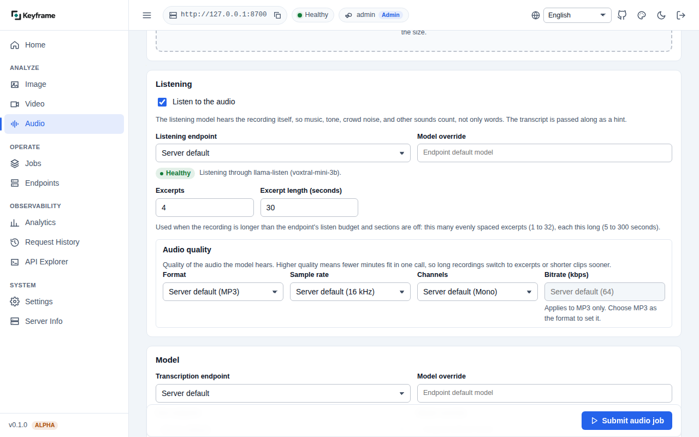

# Keyframe Audio Enhancements Plan

Keyframe's audio route never hears the audio it analyzes. `POST /v1.0/audio` transcribes the recording, then hands the transcript to a text model, so every summary and every field is answered from words alone. That works for a meeting or an interview. It falls apart on music. An instrumental track produces an empty transcript and Keyframe skips the summary with a warning. A question like "is this live or a studio recording" gets answered from stage banter if there is any and guessed if there is not, because the crowd noise, the room, and the applause never reach the model.

The fix is smaller than the problem sounds. PolyPrompt 5.0.0, which Keyframe already references, supports audio input on chat (`ContentPart.Audio`, `Capability.AudioInput`) for Gemini and OpenAI-compatible servers, which include llama.cpp's `llama-server` and vLLM. Keyframe's own seam (`InferenceRequest`) simply has no place to put audio. This plan adds that place, then builds three things on top of it that follow patterns video already established: deterministic measurements before any model runs, silence-based sections that mirror scenes, and sampled excerpts that mirror `SampleFrames`. Video scenes get their audio too.

Listening is on by default, because hearing the audio is the point of the change. It degrades safely: when no audio-capable endpoint is available, the request runs transcript-only exactly as it does today, and the response says plainly that no listening model was used (`Listening.Listened: false` with a reason code). The shipped configuration listens through a llama-server on the host (the same pattern Ollama follows today), with opt-in compose profiles that run llama-server on CPU or vLLM with Voxtral on a GPU in containers. A deployment without any of them still works and still gets two additive response objects (`Measurements` and `Listening`). A caller who wants the old behavior regardless of configuration sends `"Listen": { "Enable": false }`.

Status markers: `[x]` done, `[~]` in progress, `[ ]` not started. Update them and the progress log (section 11) at the end of every session. This is the active plan for this work, as `CLAUDE.md` says; `archive/KEYFRAME_PLAN.md` is not read or updated.

---

## 1. Decisions

These are the decisions this plan is built on. Each one can be revisited, but the rest of the plan assumes them, so change the table first if one moves.

| # | Decision | Reason |
|---|---|---|
| AD1 | **No PolyPrompt change is required.** Keyframe uses `ContentPart.Audio` and `Capability.AudioInput` from PolyPrompt 5.0.0 as shipped. | Verified in `~/Code/Polyprompt/MULTIMEDIA.md` and the client capability flags. Audio input exists on `GeminiClient` and `OpenAiCompatibleClient`. It does not exist on `OllamaClient`, `OllamaCloudClient`, `AnthropicClient`, `CohereClient`, `XAiClient`, or the Responses-API `OpenAiClient`/`AzureOpenAiClient`. `ClientOptions.MaxInlineMediaBytes` (default 20 MB, counted as encoded on the wire) exists. The OpenAI-compatible `input_audio.format` is derived from the media type (`mp3`, `wav`, `flac`, `m4a`). |
| AD2 | **Listening is configurable per request and on by default** (`AudioAnalysisRequest.Listen.Enable`, default `true`). When no audio-capable endpoint can be resolved, or the resolved endpoint is unhealthy, the request falls back to transcript-only analysis and the response records it: `Listening.Listened` is `false`, `Listening.Mode` is `None`, `Listening.Reason` carries a stable code, and a warning is added. | Owner decision. Hearing the audio is the default product behavior. The fallback keeps Keyframe working when the listening server is still loading, stopped, or absent, and the response shape makes it impossible to mistake a transcript-only answer for a listened one. |
| AD2a | **Submission rejects four cases with `400`:** a request that names a listening endpoint (`Listen.Model.Endpoint`) that is missing, inactive, or not a completion endpoint; one that names an endpoint whose provider lacks audio input; a request with Transcribe off, listening enabled, at least one model function (Summarize, Extract, or a section function), and no usable audio-capable endpoint (it would have no evidence at all); and a `Flac` rendition aimed at an `OpenAiCompatible` listening endpoint (OpenAI and llama-server accept only `wav` and `mp3`). Measure never counts as a model function for this rule. | A caller who explicitly names a model expects it to be used, a request that can only produce empty results should never become a job, and a format the server will refuse is a bad request, not a failed job. Startup ordering (AD13c) makes the second case rare in the shipped stack. |
| AD2b | **A listening call that fails while the job runs is reported as a function error.** Keyframe does not rerun the function on the transcript. The error is added to `Errors`, the function's stage fails, and `Listening` still describes what was sent. | Owner decision. A silent second attempt on different evidence would hide a real failure and double the cost. |
| AD3 | **The listening model is `AudioAnalysisRequest.Listen.Model`**, falling back to `Inference.DefaultListening`. There is no further fallback to the vision or text endpoints. | Parallels `VideoAnalysisRequest.Model` (the model that looks) and `Inference.DefaultVision`, but lives inside `Listen` so all listening options sit together. `TextModel` keeps its current meaning: transcript-only work, the fallback path, and the reduce step. |
| AD4 | **When listening, the transcript is a hint, not the evidence.** The prompt says the audio is attached, the transcript is machine-generated, and the audio wins when they disagree. | Speech recognition on sung vocals is unreliable. The listening model hears what Whisper missed and should not be anchored to its mistakes. |
| AD5 | **Summarize and Extract need Transcribe or Listen**, not Transcribe alone. The empty-transcript skip applies only when not listening. | Lets instrumental music be analyzed. |
| AD6 | **Models never choose boundaries.** Sections come from ffmpeg `silencedetect`; excerpts come from even sampling. | The same rule scenes follow. Model-reported timestamps are never used for cutting. |
| AD7 | **Measurements run by default on audio** (`Functions.Measure.Enable` default `true`). Measure counts as a function for the "enable at least one function" rule, so a request with every other function off is a measure-only job. | Owner confirmed. One ffmpeg decode pass, no model calls, exact numbers. They are additive in the response and they improve model answers when passed as prompt notes. Callers who want the old cost profile set it to `false`. |
| AD8 | **The audio sent to a model is its own rendition**, separate from transcription chunks, and **the requestor can set it** (`Listen.Rendition`: format, sample rate, channels, bitrate). Unset members use the `Media.Listen*` server defaults: mono mp3 at 16 kHz and 64 kbps. | Owner decision. The coarse default suits the models (they downsample internally) and fits about 30 minutes under PolyPrompt's 20 MB inline default after base64; callers who care about stereo image or high frequencies can ask for more. |
| AD9 | **Long audio degrades in a declared way, never silently.** Full audio if it fits, otherwise per-section audio when sections are on, otherwise evenly sampled excerpts. The response says which happened (`Listening.Mode`, which describes what the whole-recording functions heard) and what was heard (`Listening.Clips`, each tagged with its `Scope`). | `BENCHMARKING.md` (Product Hooks) requires a flag on any fallback. A caller has to know that "no profanity" was judged on 4 minutes of a 90-minute set. |
| AD10 | **Submission validates; the job decides.** `Preflight` applies only the AD2a rejections. Whether listening happens (endpoint resolution, capability, health) is decided once when the job starts running, so a job that waited in the queue uses current health, and every function in the job hears the same evidence. | A bad request never becomes a failed job, a queued job never acts on stale health, and no decision object has to be threaded through the job queue. |
| AD10a | **Video scenes include their audio by default** (`ScenesSpec.Audio.Enable`, default `true`). When the vision endpoint cannot take audio, scenes run on frames and transcript as today and `VideoAnalysisResponse.Listening` records it. Video never returns `400` for this, because the vision model is chosen for seeing. A scene longer than the listen budget sends a centered excerpt, as sections do. | Owner decision. Matches the audio default while keeping every existing video request working. |
| AD11 | **No database migration.** New stages and purposes are stored as strings; new response objects live in `ResultJson`; `InputAudioBytes` columns already exist on `analyses` and `modelcalls`. | Confirmed in `Database/Common/AnalyticsMethodsBase.cs` and the four `SetupQueries.cs` files. `AnalysisRecord.InputAudioBytes` already sums every model call, so it now also counts audio sent to completion models; that semantic change is documented in `TELEMETRY.md`. |
| AD12 | **No version change.** Entries go under the existing `## v0.1.0 (unreleased, alpha)` heading in `CHANGELOG.md`. | `VERSIONING.md` section 4. |
| AD13 | **The shipped configuration listens through llama-server on the host, following the Ollama pattern.** `docker/keyframe.json` and `docker/factory/keyframe.json` add a `llama-listen` endpoint at `http://host.docker.internal:8720/v1` and set `Inference.DefaultListening` to it. A `listen` compose profile adds `keyframe-llama` (llama.cpp `llama-server`, CPU build) for operators who want it in a container, and a `listen-gpu` profile adds `keyframe-vllm` (vLLM serving Voxtral Mini 3B) as the `vllm-voxtral` endpoint. All are `OpenAiCompatible` endpoints, so Keyframe needs no provider code. | Owner decision. Today the vision and text models come from Ollama on the host and the Ollama container is an opt-in profile. Docker on Apple Silicon has no Metal access, so a host llama-server is far faster there, and a default container would add a multi-gigabyte download and 4 to 6 GB of RAM to every `docker compose up`. |
| AD13a | **The default model is chosen by a Phase 0 bake-off**, with the license read first. Bake-off result (2026-11-17, owner's GB10): Voxtral Mini 3B is the default. The shipped configuration uses Voxtral Mini 3B (`ggml-org/Voxtral-Mini-3B-2507-GGUF:Q4_K_M`, Apache 2.0) as a provisional default in `docker/compose.yaml` (`listen` profile), the `llama-listen` endpoint (model name `voxtral-mini-3b`), and the README; the bake-off winner replaces it in those three places. Pinned images: `ghcr.io/ggml-org/llama.cpp:server-b12063` (built 2026-11-03, amd64 and arm64, has curl) and `vllm/vllm-openai:v0.33.0` (2026-11-02). Candidates: Voxtral Mini 3B (`ggml-org/Voxtral-Mini-3B-2507-GGUF`, Apache 2.0), Qwen2.5-Omni-3B (`ggml-org/Qwen2.5-Omni-3B-GGUF`, Q4_K_M; believed to carry the non-commercial Qwen Research License, which would disqualify it), Qwen2.5-Omni-7B (Apache 2.0), and Gemma 4 E2B. The winner must (1) carry a license that permits redistribution in a default stack, (2) load in llama-server and accept `input_audio` mp3, including several audio parts in one message, (3) answer the music test set acceptably, and (4) analyze a 2-minute clip on 4 CPU cores within the endpoint timeout. | Qwen2.5-Omni was trained on general sound and music, not only speech, which suits the music questions this work exists for; Voxtral is speech-first. The license check comes first because it can eliminate a candidate before any benchmarking. |
| AD13b | **Every model server keeps its models across restarts and factory resets.** Ollama keeps its existing `./ollama-models:/root/.ollama` bind mount. The `keyframe-llama` container gets `./llama-models` mounted at its cache directory (`LLAMA_CACHE`), and vLLM gets `./vllm-models` mounted at `/root/.cache/huggingface`. All three directories are git-ignored, docker-ignored, and preserved by `docker/factory/reset.sh` and `reset.bat`, matching how the Whisper model volume and `ollama-models` are treated today. | Owner decision. Models are gigabytes; a restart or reset must never download them again. Bind mounts in `docker/` follow the established Ollama pattern and make the files easy to find and delete by hand. |
| AD13c | **Model containers boot first, and an unhealthy listening endpoint is still a fallback.** `keyframe-server` declares `depends_on` with `condition: service_healthy` and `required: false` on the profile model containers (`ollama`, `keyframe-llama`, `keyframe-vllm`), so a model container that is part of the run must be healthy before the server starts, and one whose profile is not active is skipped. Host-run model servers cannot be ordered by compose, and a container can still crash or restart later, so the job also checks `EndpointHealthService`: an unhealthy listening endpoint falls back with reason `EndpointUnhealthy`. The health service re-probes unhealthy endpoints on a short interval (`Inference.UnhealthyProbeIntervalMs`, default 15000) and healthy ones on the existing long interval (`Inference.HealthProbeIntervalMs`, default 300000), both settings instead of the hard-coded five minutes. A real call that gets no HTTP response (connection refused) marks the endpoint unhealthy at once through `IEndpointHealthLookup.ReportUnreachable`, so a server that stops after a good probe is noticed by the first failed call, not the next five-minute probe; timeouts and HTTP errors do not change health. A probe never waits behind real work: when the endpoint's concurrency gate is full, the endpoint is busy, not down, and its last state is kept. | Owner decision (startup order). The trade-off is accepted: on the first start with a model profile, the server waits for the model download. The health changes stop a busy single-slot CPU endpoint from looking unhealthy and stop a recovered endpoint from falling back for five more minutes. |
| AD13d | **Local listening endpoints get their own listen budget.** A new nullable `EndpointSettings.MaxListenSeconds` overrides `Media.MaxListenSeconds` per endpoint. The shipped `llama-listen` endpoint uses 120 seconds and a 600000 ms timeout, so longer recordings are heard as excerpts or per-section clips instead of one long CPU prefill. | A 3B model on CPU spends minutes on a long clip, and its context window is far smaller than Gemini's. The degraded mode is reported in `Listening.Mode` as always (AD9). |
| AD14 | **Public-facing docs get the humanizer pass** after they are updated: `README.md`, `DOCKERHUB_README.md`, `REST_API.md`, `MCP_API.md`, the three SDK READMEs, and `dashboard/README.md`. This plan does not. | Owner decision, per `WRITING_DOCUMENTS.md` (Review for Human Voice). The pass must not add or drop any fact, and the API references keep their tables and exact names. |
| AD15 | **Booleans are named for the positive state with `Enable`:** a new on/off option is an object `"{Thing}": { "Enable": true }` or a member named `Enable`. Never `Enabled`, `{Thing}Disabled`, `Include{Thing}`, or a negative reason code. Applied here as `Listen.Enable`, `Scenes.Audio.Enable`, `Measure.Enable`, `Sections.Enable`, and the reason `NotRequested`. The two existing members that used `Enabled` (`Analytics.Enabled` and `RequestHistory.Enabled`) are renamed to `Enable` everywhere (Core, SDKs, server, dashboard, Postman, docs, and the shipped `docker/` settings files), with no compatibility alias. | Owner decision. Every other on/off member already uses `Enable` (`Telemetry.Enable`, the MCP transport settings, `Summarize`, `Extract`, `Scenes`, `Transcribe`). Keyframe is unreleased alpha, so the rename is a clean break noted in `CHANGELOG.md`. |
| AD16 | **Live-provider credentials are requested from the owner, never stored.** `TESTING.md` instructs an agent to ask the owner for the Gemini key, the OpenAI key, and the GPU host before running live cases, and to pass them only as the existing live-test environment variables (`GEMINI_API_KEY`, `OPENAI_API_KEY`, `KEYFRAME_TEST_*`) for that session. | Owner decision. The owner has all three; keys never enter the repository, test data, logs, or screenshots. |

---

## 2. Requirements Compliance

The requirement documents in `~/Code/Agents/requirements` are normative, with two deliberate, standing exceptions: authentication is DocumentAtom-style (an admin key and access keys) rather than full AAA, and routes use the `/v1.0` prefix. The table below covers what this change adds or touches.

| Requirement | What this change must do |
|---|---|
| `CODE_STYLE.md`, `CLAUDE.md` | One class or enum per file, no `var`, no tuples, usings inside the namespace, XML docs with defaults, minimums, maximums and `<exception>` tags on every public member, explicit setters with `Math.Clamp` for every new range, `ConfigureAwait(false)` and a `CancellationToken` on every async method, classic `using` blocks, no `Console.WriteLine` in Core, no em-dashes anywhere. |
| `BACKEND_ARCHITECTURE.md` (Models and DTOs, JSON Rule, Request Validation) | Every new shape is a named DTO in `Requests/` or `Responses/`. No `JsonElement` or `JsonNode`. `RequestValidator` returns every problem at once. |
| `BACKEND_ARCHITECTURE.md` (Runtime settings management API) | New settings are typed, clamped, described by `SettingsManager` metadata (Live or Restart), and validated per field on `PUT /v1.0/settings`. Keyframe has no generic `KEYFRAME_*` override for every setting (only the settings file, admin key, and access key variables), so none is added here. |
| `BACKEND_ARCHITECTURE.md` (API Surface) | OpenAPI descriptions updated in `Routes/AnalysisRoutes.cs` and `Routes/EndpointRoutes.cs`; schemas come from `OpenApiSchemaFactory` reflection, so new properties need complete XML docs to render well in the API Explorer. |
| `BENCHMARKING.md` (Product Hooks for Measurement) | Fallbacks are flagged in the response (`Listening.Mode`, warnings). The measure-only path shares code with the full path. |
| `TELEMETRY_REQUIREMENTS.md` | Each new stage gets a span and a duration sample through `StageTimer`/`KeyframeMetrics.RecordStage`. Each new ffmpeg operation is recorded through `RecordFfmpeg`. New metrics use the `keyframe.` prefix with low-cardinality labels only (`media_kind`, `stage`, `purpose`, `provider`, `operation`, `mode`). Grafana panels updated in `assets/grafana/` and mirrored to `docker/grafana/dashboards/`. |
| `BACKEND_TEST_ARCHITECTURE.md` | New cases are Touchstone descriptors in `Test.Shared`, with no console output, using `127.0.0.1`, and running under `Test.Automated`, `Test.Xunit3`, and `Test.Nunit`. ffmpeg-dependent cases skip with a reason when ffmpeg is absent. Analytics round-trips run on all four providers in CI. SDK harnesses gain matching cases. |
| `FRONTEND_ARCHITECTURE.md`, `DASHBOARD_STYLE_AND_USABILITY.md` | Labeled form controls with helper text and the same clamps as the backend, toggles for booleans, selects for bounded sets, no browser dialogs, loading, empty, and error states on every new panel, hand-rolled SVG for the section timeline, results as key/value grids with copy and a raw JSON view, visual QA at 1280, 768, and 390 in light and dark, and a dashboard container rebuild. |
| `I18N.md` | Every new string is a key in all twelve locales (`en es pt fr it de zh ar ru ms hi ja`), units go through the shared formatters, and `i18n.test.js` (parity, orphans, hard-coded strings, dashes) stays green. |
| `REPOSITORY_REQUIREMENTS.md` items 13 and 14 | `REST_API.md`, the Postman collection, and `MCP_API.md` updated in the same change as the surface. |
| `SIMULATED_USER_TESTING.md` | A simulated user session runs every new doc example and Postman request as written before the work is called done (Phase 7). |
| `VERSIONING.md` | No version change (AD12). |

---

## 3. API Contract Changes

### 3.1 `POST /v1.0/audio` request

New member on `AudioAnalysisRequest`: `Listen` (ListenSpec, never null). Every listening option lives inside it, so the request has one place to turn listening on or off and to tune it:

| `ListenSpec` member | Type | Default | Range | Meaning |
|---|---|---|---|---|
| `Enable` | boolean | `true` | | Send the audio itself to the listening model for Summarize, Extract, and per-section functions. Falls back to transcript-only, with `Listening.Listened: false`, when no audio-capable endpoint resolves. |
| `Model` | ModelSelection | null | | Listening endpoint and model. Null uses `Inference.DefaultListening`. Ignored unless `Enable` is true. Naming an endpoint without audio input is a `400`. |
| `Rendition` | AudioRenditionSpec | all null | | Quality of the audio sent to the listening model. Each null member uses its `Media.Listen*` default (3.6). |
| `SampleClips` | integer | 4 | 1 to 32 | Excerpts sent when the audio is too long to send whole and sections are off. |
| `ClipSeconds` | integer | 30 | 5 to 300 | Length of each excerpt. |

New members on `AudioFunctionsSpec`:

| Member | Type | Default | Meaning |
|---|---|---|---|
| `Measure` | MeasureSpec (`Enable`) | `Enable: true` | Deterministic loudness, level, silence, and stereo measurements. No model calls. |
| `Sections` | SectionsSpec | `Enable: false` | Split the recording at silences and run per-section functions. |

`SectionsSpec` mirrors `ScenesSpec`:

| Member | Default | Range | Notes |
|---|---|---|---|
| `Enable` | false | | |
| `Detection.SilenceDb` | -40 | -90 to -10 | Level below which audio counts as silence (dBFS). |
| `Detection.MinSilenceMs` | 1500 | 100 to 30000 | Shortest silence that can separate sections. |
| `Detection.MinSectionMs` | 20000 | 0 to 600000 | Shorter sections merge into a neighbor. |
| `Detection.MaxSectionMs` | 600000 | 10000 to 3600000 | Longer sections split evenly. |
| `Detection.MaxSections` | 100 | 1 to 1000 | Excess sections merge. |
| `Summarize`, `Extract` | disabled | | Per-section functions, same shape as everywhere else. |

`AudioRenditionSpec` (used by `Listen.Rendition` on audio and `Scenes.Audio.Rendition` on video):

| Member | Type | Default when null | Range |
|---|---|---|---|
| `Format` | `Mp3`, `Wav`, `Flac` | `Media.ListenFormat` (`Mp3`) | |
| `SampleRate` | integer | `Media.ListenSampleRate` (16000) | 8000 to 48000 |
| `Channels` | integer | `Media.ListenChannels` (1) | 1 to 2 |
| `BitrateKbps` | integer | `Media.ListenBitrateKbps` (64) | 16 to 320, Mp3 only |

A larger rendition means fewer minutes per call. The inline-size estimate in 3.6 uses the effective rendition, so a caller who asks for stereo 44.1 kHz at 192 kbps simply gets excerpts or per-section clips sooner, and `Listening.Mode` says so.

When sections are enabled and `TextModel` is set, the whole-recording summary and fields are reduced from the section results with the text model, exactly as video reduces from scenes. Without `TextModel`, the whole-recording functions run on the full audio or on excerpts.

Example:

```json
POST /v1.0/audio
{
  "Audio": { "Url": "https://example.com/track07.flac" },
  "Listen": { "Enable": true, "Model": { "Endpoint": "llama-listen" } },
  "Context": [ { "Label": "Artist", "Text": "Archive of a touring rock band, 1978 to 1994." } ],
  "Functions": {
    "Transcribe": { "Enable": true, "Prompt": "Band member names: ..." },
    "Summarize": { "Enable": true, "MaxWords": 80 },
    "Extract": { "Enable": true, "Fields": [
      { "Key": "chorusLyrics", "Type": "String", "Prompt": "Lyrics of the chorus." },
      { "Key": "recording", "Type": "Enum", "Options": [ "Live", "Studio", "Rehearsal", "Demo" ], "Prompt": "How was this recorded?" },
      { "Key": "explicit", "Type": "Boolean", "Prompt": "Does it contain profanity?" },
      { "Key": "instruments", "Type": "StringList", "Prompt": "Instruments you can hear." }
    ] }
  }
}
```

Validation changes in `RequestValidator.Validate(AudioAnalysisRequest)`:

- "Enable at least one function" counts Transcribe, Summarize, Extract, Measure, and Sections (replaces the rule at `RequestValidator.cs:136`). Because Measure defaults to on, a request with every other function off is a measure-only job (AD7).
- Summarize, Extract, and section functions require `Transcribe.Enable` or `Listen.Enable` (replaces the rule at `RequestValidator.cs:139`). With the new default, a request that turns Transcribe off still validates because Listen is on.
- Section functions require `Sections.Enable`.
- Every new numeric member is clamped by its setter; the validator reports only structural problems (for example `MaxSectionMs` below `MinSectionMs`).

A model function below means Summarize, Extract, or a section function. Measure is never one.

Listening resolution is one shared routine, `ListenPlanner.Resolve`, used by both `Preflight` and the job (AD10). When `Listen.Enable` is false the result is `NotRequested`; when no model function is enabled it is `NoModelFunctions`. Otherwise:

1. If `Listen.Model.Endpoint` is named and its provider lacks audio input (`PolyPromptClientBuilder.SupportsAudioInput` is false), the result is a rejection: `"Endpoint 'ollama-gemma3-4b' cannot take audio input. Choose an endpoint whose provider supports audio (Gemini, OpenAiCompatible), or set Listen.Enable to false."`
2. Otherwise resolve `Inference.DefaultListening`. If it is unset or inactive, fall back with `NoEndpointConfigured`; if it lacks audio input, `EndpointLacksAudioInput`.
3. If the resolved endpoint (named or default) is currently unhealthy in the health lookup, fall back with `EndpointUnhealthy` (AD13c). A named endpoint that is unhealthy falls back rather than failing, because health is transient. An endpoint the health service has not checked yet (null) is treated as usable: the first probe runs within a second of startup, and a call that then fails is a function error (AD2b).
4. If the effective rendition format is `Flac` and the endpoint provider is `OpenAiCompatible`, the result is a rejection: `"Endpoint 'llama-listen' (OpenAiCompatible) accepts only Mp3 or Wav audio. Set Listen.Rendition.Format to Mp3 or Wav."`

`AudioAnalyzer.Preflight` runs the routine and throws `RequestValidationException` (`400`) for a rejection, and also when the result is a fallback while Transcribe is off and a model function is enabled: `"Nothing to analyze: no usable audio-capable endpoint and Transcribe is off."` It does not carry the result into the job. `AnalyzeAsync` runs the routine again when the job starts, so a queued job uses current health; a rejection at that point (for example because the settings changed while the job waited) fails the job with the same message.

### 3.2 `POST /v1.0/audio` response

New members on `AudioAnalysisResponse`:

| Member | Type | Present when |
|---|---|---|
| `Measurements` | AudioMeasurements | `Functions.Measure.Enable` and the measurement succeeded (an ffmpeg failure adds a `Measure:` error and leaves it null) |
| `Listening` | ListeningInfo | always (including when `Listen.Enable` is false, with reason `NotRequested`) |
| `Sections` | SectionResult[] | `Functions.Sections.Enable` |

`Listening` is always present so a consumer never has to infer from absence whether the audio was heard. Its members:

| Member | Type | Notes |
|---|---|---|
| `Listened` | boolean | True only when at least one model call carried audio, including a call that then failed (AD2b). |
| `Mode` | `Full`, `Sections`, `Excerpts`, `Scenes`, `None` | What the whole-recording functions heard (section 4). `Scenes` appears only on video. `None` whenever `Listened` is false. |
| `Reason` | `NotRequested`, `NoModelFunctions`, `NoEndpointConfigured`, `EndpointLacksAudioInput`, `EndpointUnhealthy`, `NoAudioTrack`, null | Stable code, null when listening happened. The dashboard and SDKs localize it; the server never sends prose here. |
| `Endpoint`, `Model` | string | The listening endpoint and model, null when not listened. |
| `Rendition` | AudioRenditionSpec | The effective rendition, every member filled. |
| `DurationMs`, `HeardMs` | integer | Length of the media and the length of the distinct audio the models heard (overlapping clips are counted once). |
| `Clips` | ListenClip[] | One entry per clip rendered: `Scope` (`Recording`, `Section`, or `Scene`), `Index` (the section or scene index, null for `Recording`), `StartMs`, `EndMs`, `SizeBytes`. Empty when not listened. |

```json
"Measurements": {
  "IntegratedLufs": -9.4, "LoudnessRangeLu": 5.1, "TruePeakDbtp": -0.2,
  "PeakDbfs": -0.3, "RmsDbfs": -11.8, "CrestFactorDb": 11.5,
  "PeakCount": 214, "ClippingLikely": true,
  "SilenceRatio": 0.03, "SilenceCount": 2, "LeadingSilenceMs": 400, "TrailingSilenceMs": 2100,
  "Channels": 2, "StereoWidthDb": -14.2, "EffectivelyMono": false
},
"Listening": {
  "Listened": true, "Mode": "Excerpts", "Reason": null,
  "Endpoint": "llama-listen", "Model": "qwen2.5-omni-3b",
  "Rendition": { "Format": "Mp3", "SampleRate": 16000, "Channels": 1, "BitrateKbps": 64 },
  "DurationMs": 241000, "HeardMs": 120000,
  "Clips": [ { "Scope": "Recording", "Index": null, "StartMs": 0, "EndMs": 30000, "SizeBytes": 240000 }, "..." ]
},
"Sections": [
  { "Index": 0, "StartMs": 0, "EndMs": 241000, "DurationMs": 241000,
    "TranscriptText": "...", "Results": { }, "Fields": [ ], "Errors": [ ] }
]
```

That example is the shipped stack: the 4-minute track exceeds the `llama-listen` endpoint's 120-second budget (AD13d), so the model heard four 30-second excerpts. Against a Gemini or vLLM endpoint with the default 1200-second budget, the same request reports `Mode: Full` and one clip.

When the host llama-server is stopped or still loading its model, the same request returns transcript-only results and:

```json
"Listening": {
  "Listened": false, "Mode": "None", "Reason": "EndpointUnhealthy",
  "Endpoint": null, "Model": null,
  "Rendition": { "Format": "Mp3", "SampleRate": 16000, "Channels": 1, "BitrateKbps": 64 },
  "DurationMs": 241000, "HeardMs": 0, "Clips": []
}
```

Excerpts and every audio fallback add a warning (`Sections` does not, and a section or scene clip shortened to fit is visible only in `Clips`), for example `"The listening endpoint 'llama-listen' is unhealthy; results come from the transcript only."` or `"Listened to 4 excerpts (2m00s) of a 1h32m recording."`. No warning is added for `NotRequested` or `NoModelFunctions`, because nothing asked to listen. `StereoWidthDb` is the side-to-mid RMS level difference in dB and is null for mono sources; `EffectivelyMono` is true for a mono source or when `StereoWidthDb` is at or below `Media.MonoMaxSideDb`. `ClippingLikely` is true when `TruePeakDbtp` is at or above `Media.ClippingTruePeakDbtp` and `PeakCount` per minute of audio is at or above `Media.ClippingMinPeaksPerMinute`; the raw inputs are reported alongside it so callers can apply their own threshold. The silence figures in `Measurements` use `Media.MeasureSilenceDb` and `Media.MeasureMinSilenceMs`, independent of section detection.

`SectionResult` has the shape of `SceneResult` without `Keyframes`. Each section can be cut back out with the existing `POST /v1.0/segment`.

### 3.3 `POST /v1.0/video`

New member on `ScenesSpec`: `Audio` (SceneAudioSpec, never null):

| `SceneAudioSpec` member | Type | Default | Meaning |
|---|---|---|---|
| `Enable` | boolean | `true` | Attach each scene's audio to that scene's model calls. |
| `Rendition` | AudioRenditionSpec | all null | Quality of the scene audio, with the same `Media.Listen*` defaults as audio. |

```json
"Scenes": { "Enable": true, "Audio": { "Enable": true, "Rendition": { "Channels": 2 } } }
```

When the vision endpoint lacks audio input, is unhealthy, or the video has no audio track, scenes run on frames and transcript as today; nothing is rejected (AD10a). The default Ollama vision endpoints lack audio input, so on the shipped stack scene audio reports `EndpointLacksAudioInput` until the operator points `Model` at an audio-capable vision endpoint such as Gemini.

`VideoAnalysisResponse.Listening` (ListeningInfo) is present whenever scenes are enabled: `Mode: Scenes` when scene calls carried audio, otherwise `Mode: None` with reason `NotRequested`, `NoModelFunctions`, `EndpointLacksAudioInput` (also used when the rendition format is one the vision endpoint refuses), `EndpointUnhealthy`, or `NoAudioTrack`. Only `EndpointUnhealthy` adds a warning, because the others are expected configuration, not degradation. A scene longer than the vision endpoint's listen budget, or whose clip would exceed `MaxInlineMediaBytes`, carries a centered excerpt that fits. The whole-video step is unchanged.

### 3.4 `GET /v1.0/endpoints`

`EndpointResponse.SupportsAudioInput` (boolean), filled from `PolyPromptClientBuilder.SupportsAudioInput`. True for `Gemini`, `OpenAiCompatible`, and `Mock`.

### 3.5 Enums

| Enum | New values |
|---|---|
| `AnalysisStageEnum` | `Measure`, `SectionDetection`, `ListenExtraction` (after `AudioExtraction`), `Sections` (after `Scenes`) |
| `ModelCallPurposeEnum` | `SectionSummarize`, `SectionExtract` |
| `ListeningModeEnum` (new) | `Full`, `Sections`, `Excerpts`, `Scenes`, `None` |
| `ListenSkipReasonEnum` (new) | `NotRequested`, `NoModelFunctions`, `NoEndpointConfigured`, `EndpointLacksAudioInput`, `EndpointUnhealthy`, `NoAudioTrack` |
| `ListenFormatEnum` (new) | `Mp3`, `Wav`, `Flac` |
| `ListenClipScopeEnum` (new) | `Recording`, `Section`, `Scene` |

Enums persist as strings and analytics orders stages by enum ordinal, so inserting values changes display order only. Phase 1 confirms nothing persists ordinals.

### 3.6 Settings

| Setting | Default | Range | Apply |
|---|---|---|---|
| `Inference.DefaultListening` | null in code; `llama-listen` in the shipped `docker/keyframe.json` | endpoint name | Live |
| `Media.ListenFormat` | `Mp3` | `Mp3`, `Wav`, `Flac` | Live; default for `Listen.Rendition.Format` |
| `Media.ListenSampleRate` | 16000 | 8000 to 48000 | Live; default for `Listen.Rendition.SampleRate` |
| `Media.ListenChannels` | 1 | 1 to 2 | Live; default for `Listen.Rendition.Channels` |
| `Media.ListenBitrateKbps` | 64 | 16 to 320 (Mp3 only) | Live; default for `Listen.Rendition.BitrateKbps` |
| `Media.MaxListenSeconds` | 1200 | 10 to 7200 | Live |
| `Endpoints[].MaxInlineMediaBytes` | 20971520 | 1048576 to 1073741824 | Live (a saved settings change replaces the endpoint object, and the client cache rebuilds on a new object) |
| `Endpoints[].MaxListenSeconds` | null (uses `Media.MaxListenSeconds`) | 10 to 7200 | Live; 120 on the shipped `llama-listen` endpoint (AD13d) |
| `Media.MeasureSilenceDb` | -50 | -90 to -10 | Live; silence threshold for `Measurements` |
| `Media.MeasureMinSilenceMs` | 500 | 100 to 30000 | Live; shortest silence counted in `Measurements` |
| `Media.ClippingTruePeakDbtp` | -0.1 | -6 to 3 | Live; `ClippingLikely` true-peak threshold |
| `Media.ClippingMinPeaksPerMinute` | 10 | 0 to 100000 | Live; `ClippingLikely` peak-count threshold |
| `Media.MonoMaxSideDb` | -40 | -120 to 0 | Live; `EffectivelyMono` threshold on `StereoWidthDb` |
| `Inference.HealthProbeIntervalMs` | 300000 | 10000 to 3600000 | Live; re-probe interval for healthy endpoints (replaces the hard-coded five minutes) |
| `Inference.UnhealthyProbeIntervalMs` | 15000 | 1000 to 600000 | Live; re-probe interval for unhealthy or never-checked endpoints (AD13c) |

`MaxInlineMediaBytes` is passed to PolyPrompt `ClientOptions` in `PolyPromptClientBuilder.Build`. Keyframe checks the rendered clips, not an estimate: after rendering, the wire size of a call's clips (base64 of the actual bytes plus the data-URL prefix) is compared with the endpoint's `MaxInlineMediaBytes`. A `Full` clip that does not fit moves to the next mode; excerpt and section clips that do not fit are re-rendered shorter in proportion, with a warning, rather than letting PolyPrompt reject the call. A planning estimate (`bitrate x seconds / 8` for Mp3, `sampleRate x channels x 2 x seconds` for Wav, the Wav figure for Flac) chooses the first attempt so re-rendering is rare.

### 3.7 Telemetry

| Name | Kind | Labels | Notes |
|---|---|---|---|
| `keyframe.stage.duration` | existing | `stage` gains `Measure`, `SectionDetection`, `ListenExtraction`, `Sections` | |
| `keyframe.ffmpeg.invocations`, `.duration` | existing | `operation` gains `audio_measure`, `section_detect`, `listen_extract` | |
| `keyframe.model.input.audio.bytes` | new histogram | `provider`, `purpose` | Bytes of audio attached to completion calls. |
| `keyframe.analysis.listen.total` | new counter | `media_kind`, `mode`, `reason` | One per audio analysis and per video analysis with scenes, including fallbacks (`mode=None`). `mode` is lowercase (`full`, `excerpts`, `sections`, `scenes`, `none`); `reason` is the bounded `ListenSkipReasonEnum` set in its enum spelling, or `none`. The fallback rate is the signal operators need most: it shows how many requests that asked to listen were answered from text. |

Model-call spans gain `keyframe.input_audio_clips` and `keyframe.input_audio_bytes` next to the existing `keyframe.input_images` tag set in `ModelInvoker`. No clip offsets or URLs go on metric labels.

---

## 4. Pipeline

Audio analysis after this change, with new stages in bold:

```text
Resolve -> Probe -> **Measure** -> AudioExtraction + Transcribe (when enabled)
        -> **SectionDetection** (when Sections) -> **ListenExtraction** (when Listen)
        -> **Sections** (per-section functions) -> Summarize + Extract (or Reduce from sections)
```

Measure runs first among the post-probe stages because it is cheap and its output feeds every later prompt through `MediaSubject.Notes` (for example: `"Measured: integrated loudness -9.4 LUFS, loudness range 5.1 LU, true peak -0.2 dBTP, 3% silence, stereo."`). Measurements are context, never instructions, and the prompt says so.

ListenExtraction runs `ListenPlanner.Resolve` (section 3.1) when the job starts and decides the listening mode once, before any model call, so every function in the request hears the same evidence. The listen budget is the endpoint's `MaxListenSeconds` when set, otherwise `Media.MaxListenSeconds` (AD13d).

Section functions, when sections are on and listening resolved, always hear their own section's clip (`Scope: Section`), reduced to a centered excerpt when the section is over the budget or the inline limit. The whole-recording functions hear:

0. If the resolution is a fallback or `NotRequested` or `NoModelFunctions`: mode `None`. No rendition is produced, functions run on the transcript with `TextModel` exactly as today, and `Listening` records the reason.
1. If sections are on and `TextModel` is set, or only section functions are enabled: mode `Sections`. The whole-recording summary and fields are reduced from the listened section results with the text model, exactly as video reduces from scenes. Only section clips are rendered.
2. Else, if the duration is within the listen budget and the rendered clip fits `MaxInlineMediaBytes`: mode `Full`, one clip of the whole recording (`Scope: Recording`).
3. Else: mode `Excerpts`, `SampleClips` clips of `ClipSeconds` each (`Scope: Recording`), evenly spaced and labeled in the prompt (`"Excerpt at 01:32:10 (30s)"`), sent in one call. When `SampleClips x ClipSeconds` exceeds the budget, `ClipSeconds` is shortened to fit and a warning says so.

A listening call that fails is a function error (AD2b); the job does not rerun it on the transcript.

---

## 5. Changes by Layer

File paths are relative to the repository root. Each item names the file, the change, and the pattern it copies.

### 5.1 Core: inference seam

- `src/Keyframe.Core/Inference/InferenceAudio.cs` (new): `Data`, `MediaType` (default `audio/mpeg`), `Label`, `Sha256`, `StartMs`, `EndMs`. Copies `InferenceImage`.
- `Inference/InferenceRequest.cs`: add `List<InferenceAudio> Audio` (never null).
- `Inference/Providers/PolyPromptInferenceClient.cs`: next to the `ImageInput` check (line ~107) throw `CapabilityNotSupportedException` for `AudioInput`; in `BuildMessages` (line ~224) append each label and `ContentPart.Audio(data, mediaType)` after images.
- `Inference/Providers/PolyPromptClientBuilder.cs`: add `SupportsAudioInput(EndpointSettings)`; pass `MaxInlineMediaBytes` to `ClientOptions`.
- `Settings/EndpointSettings.cs`: add `MaxInlineMediaBytes` and nullable `MaxListenSeconds`, both clamped.
- `Inference/MockInferenceClient.cs`: seed deterministic output from image and audio hashes; summary text `"Mock summary of N images and M audio clips"`; estimate audio prompt tokens (32 per second, matching Gemini's published rate) so telemetry totals are exercised.
- `Analysis/ModelInvoker.cs` (lines ~74 to 89): set `InputAudioBytes` and the new span tags; record `keyframe.model.input.audio.bytes`.

### 5.2 Core: media

- `Media/AudioMeasurer.cs` (new): one ffmpeg pass, `-af ebur128=peak=true,astats,silencedetect=n=<db>:d=<s>` to `-f null -`, plus a second `pan` and `astats` pass for stereo width when the source has two channels. Operation `audio_measure`.
- `Media/AudioMeasurementParser.cs` (new, static, pure): parses the ebur128 summary, the astats overall block, and silencedetect lines from stderr. Kept separate so tests can feed captured stderr without ffmpeg.
- `Media/SectionDetector.cs` (new): `silencedetect` at the requested threshold, cuts at silence midpoints. Operation `section_detect`. Parsing is a public static method, like `SceneDetector.ParseCuts`.
- `Media/BoundaryBuilder.cs` (new, static): the merge and split logic now inside `SceneDetector.BuildScenes`, generalized to `(cutsMs, durationMs, minMs, maxMs, maxCount, minCutSpacingMs)`. `SceneDetector.BuildScenes` delegates to it unchanged, so scene tests guard the refactor.
- `Media/ListenRenditionExtractor.cs` (new): renders a clip of `[StartMs, EndMs)` in the effective rendition (request `Listen.Rendition` over `Media.Listen*` defaults, resolved by a small static `RenditionResolver`). Operation `listen_extract`. Reuses the argument patterns from `SegmentExtractor.AudioArguments`.
- `Media/ClipSampler.cs` (new, static): evenly spaced excerpt windows, the audio twin of `FrameSampler.Evenly`.
- `Settings/MediaSettings.cs`, `Settings/InferenceSettings.cs`: the settings in 3.6.

### 5.3 Core: analysis

- `Analysis/ListenPlanner.cs` (new): the shared resolution routine in 3.1 (named or default endpoint, capability, health, format compatibility), returning a `ListenPlan` (endpoint or null, reason, rejection message or null). Used by audio preflight, the audio job, and video scenes.
- `Analysis/AudioAnalyzer.cs`: `Preflight` applies the AD2a rejections only; `AnalyzeAsync` resolves listening again when the job starts (AD10); new stages in pipeline order; listening call failures reported as function errors (AD2b); listening mode decision including the `None` fallback, its warning, and an always-populated `Listening`; `BuildSubject` gains a listening variant (`"An audio recording is attached ... a machine transcript follows as a hint ..."`) and attaches `subject.Audio`; empty-transcript skip only when not listening; sections and reduce.
- `Analysis/MediaSubject.cs`: add `List<InferenceAudio> Audio`.
- `Analysis/MediaFunctions.cs`: pass `subject.Audio` into every `InferenceRequest` (three sites today pass `Images`).
- `Analysis/PromptBuilder.cs`: an evidence line for attached audio and clip labels; measurement notes rendered as data.
- `Analysis/TranscriptSlicer.cs` (new, static): moved from `VideoAnalyzer.TranscriptSlice` so sections and scenes share it.
- `Analysis/VideoAnalyzer.cs`: `AnalyzeScenesAsync` attaches each scene's clip when `Scenes.Audio.Enable` is true and the vision endpoint supports audio and the video has an audio track; otherwise records the fallback in `Listening` (AD10a). No new `400`.
- `Analysis/AnalysisServices.cs`: register `AudioMeasurer`, `SectionDetector`, `ListenRenditionExtractor`, and an endpoint-health lookup (an interface such as `IEndpointHealthLookup`, implemented by the server's `EndpointHealthService`, so Core does not reference the server).
- `Requests/`: `ListenSpec.cs`, `SceneAudioSpec.cs`, `MeasureSpec.cs`, `SectionsSpec.cs`, `SectionDetectionSpec.cs`, `AudioRenditionSpec.cs` (new); `Listen` added to `AudioAnalysisRequest.cs`, `Audio` to `ScenesSpec.cs`, `Measure` and `Sections` to `AudioFunctionsSpec.cs`; `RequestValidator.cs` rules in 3.1.
- `Responses/`: `AudioMeasurements.cs`, `ListeningInfo.cs`, `ListenClip.cs`, `SectionResult.cs` (new); members on `AudioAnalysisResponse.cs`, `VideoAnalysisResponse.cs` (`Listening`), `EndpointResponse.cs`.
- `Enums/`: values in 3.5; `ListeningModeEnum.cs`, `ListenSkipReasonEnum.cs`, `ListenFormatEnum.cs` (new).
- `Observability/TelemetryNames.cs`, `Observability/KeyframeMetrics.cs`: the metrics in 3.7.

### 5.4 Server

- `Routes/AnalysisRoutes.cs`: rewrite the `/v1.0/audio` OpenAPI description (it still says "summary from the transcript"); mention `Scenes.Audio.Enable` on `/v1.0/video`.
- `Services/EndpointHealthService.cs` (line ~127): fill `SupportsAudioInput`; implement the health lookup used by `ListenPlanner` (AD13c), returning the last probe result without probing inline so preflight stays fast. Replace the hard-coded five-minute `_Interval` with per-endpoint scheduling: an endpoint that is unhealthy or never checked is re-probed after `Inference.UnhealthyProbeIntervalMs`, a healthy one after `Inference.HealthProbeIntervalMs`. Probe endpoints concurrently so one slow endpoint never delays the others. A probe never queues behind real work: `GatedInferenceClient` gains a non-blocking `TryCompleteAsync` (or an `IsBusy` check), and when the gate is full the probe is skipped and the endpoint's last state kept, because a busy endpoint is reachable.
- `SettingsManager.cs`: new settings appear through reflection; mark `MaxInlineMediaBytes` restart-required.
- `JobService.cs`, request history, persistence: no change (AD11). For audio analyses the listening endpoint and model are recorded in the existing `VisionEndpoint` and `VisionModel` analytics columns (the model that attends to the media, as for video), and `TextEndpoint` holds the transcript or reduce model when one is used.

### 5.5 MCP server

- `src/Keyframe.McpServer/Tools/Inputs/AudioAnalyzeInput.cs` and the inline schema in `Tools/KeyframeTools.cs` (line ~214): add the `Listen` object (`Enable` default true, `Model`, `Rendition`, `SampleClips`, `ClipSeconds`), `Measure`, and `Sections`; replace the description that says Transcribe "is required for Summarize and Fields", and tell agents to read `Listening.Listened` before trusting an answer about how the audio sounds.
- `keyframe_video_analyze`: the `Scenes.Audio` object (`Enable` default true, `Rendition`).
- `keyframe_endpoints_list`: results include `SupportsAudioInput`.

### 5.6 SDKs

All three mirror the Core DTOs field for field. Harnesses run against a live server with the mock provider, as today.

| SDK | Files |
|---|---|
| C# | `sdk/csharp/Keyframe.Sdk/Requests/AudioAnalysisRequest.cs`, `AudioFunctionsSpec.cs`, `ScenesSpec.cs`, new `ListenSpec.cs`, `SceneAudioSpec.cs`, `MeasureSpec.cs`, `SectionsSpec.cs`, `SectionDetectionSpec.cs`, `AudioRenditionSpec.cs`; `Responses/AudioAnalysisResponse.cs`, `VideoAnalysisResponse.cs`, `EndpointResponse.cs`, new `AudioMeasurements.cs`, `ListeningInfo.cs`, `ListenClip.cs`, `SectionResult.cs`; `Settings/MediaSettings.cs`, `InferenceSettings.cs`, `EndpointSettings.cs`; `Enums/AnalysisStageEnum.cs`, `ModelCallPurposeEnum.cs`, new `ListeningModeEnum.cs`, `ListenSkipReasonEnum.cs`, `ListenFormatEnum.cs`; harness `Test.Automated/SdkTests.cs`. SDK defaults match the server (`Listen.Enable` and `Scenes.Audio.Enable` true) so an SDK request and a raw request behave the same. |
| JavaScript | `sdk/js/src/index.js` (no client change expected; requests pass through), `sdk/js/src/index.d.ts` (unions and interfaces), `sdk/js/test/sdk.test.js` `describe('audio')`. |
| Python | `sdk/python/src/keyframe_sdk/models.py` (dataclasses and enums), `client.py` if helpers change, `tests/test_sdk.py`. |

### 5.7 Dashboard

- `views/AnalyzeAudioView.jsx` and `buildAudioRequest`:
  - a Listen toggle bound to `Listen.Enable`, on by default, with a `ModelPicker` limited to endpoints where `SupportsAudioInput` is true and showing each one's health; when the chosen or default endpoint is unhealthy or none exists, the toggle stays on and helper text says the analysis will fall back to the transcript (and, for a first start, that llama-server may still be downloading its model);
  - a collapsed "Audio quality" group for `Listen.Rendition` (format select, sample rate select of common rates, channels select, bitrate input clamped 16 to 320 and disabled unless the format is Mp3), with "Server default" as the initial value of each control;
  - excerpt controls (`SampleClips`, `ClipSeconds`) shown when Listen is on;
  - a Measure toggle;
  - a Sections panel with detection inputs clamped exactly like the backend and per-section Summarize and Extract;
  - `FieldBuilder` enabled when Transcribe or Listen is on (it is disabled when Transcribe is off today);
  - the `analyzeAudio.transcribeRequired` message reworded to "Turn on Transcribe or Listen".
- `components/AnalysisParts.jsx` `AnalysisResultTabs`:
  - a Measurements tab: key/value grid, values through `formatNumber` with unit keys for LUFS, LU, dBTP, dBFS and dB, copy buttons;
  - a Listening card shown on every audio result and every video result with scenes: listened or not, mode, the localized reason when not listened, endpoint, model, effective rendition, heard versus total duration, clip list, and a warning badge (icon plus text, not color alone) whenever the mode is not `Full` or `Scenes`;
  - a Sections tab.
- `components/SectionTimeline.jsx` (new): hand-rolled SVG bar of sections and silences over the recording, with keyboard focus, `aria-label`s, and per-section results. Each section offers audio downloads through the existing `SegmentDownloads`.
- `views/JobDetailView.jsx` (line ~121 hides scenes for audio): show Measurements, Listening, and Sections for audio jobs.
- `views/AnalyzeVideoView.jsx`: Scenes "Scene audio" toggle bound to `Scenes.Audio.Enable`, on by default, with helper text when the chosen vision endpoint lacks audio input ("Scenes will use frames and transcript only"), plus the same "Audio quality" group.
- `views/EndpointsView.jsx`: capability badges for images, structured output, transcription, and audio input (icon and text).
- `views/SettingsView.jsx` and `utils/settingsSchema.js`: the settings in 3.6 (including the per-endpoint `MaxInlineMediaBytes` and `MaxListenSeconds`), with `DefaultListening` as a select of audio-capable endpoints and restart badges; also add the missing `Media.MaxAudioDurationMs`.
- `components/TelemetryWaterfall.jsx`: no code change; new `enums.stage.*`, `enums.progressStage.*`, and `enums.purpose.*` keys.
- `i18n/locales/*`: every new key in all twelve locales.
- Tests: `views/features.test.jsx` and `views/views.test.jsx` for the new controls, tabs, and states; a `buildAudioRequest` unit test for every new field; `SectionTimeline` rendering and keyboard test; fixtures in `test/fixtures.js` for a listening response with sections and measurements.

### 5.8 Postman

`assets/postman/Keyframe.postman_collection.json`, Audio folder, each request with a description that explains what it demonstrates and a saved example response:

- **Listen to a track**: `Listen` with `{{listeningEndpoint}}` and the four music fields from 3.1. Its description explains that the factory configuration listens through a llama-server on the host at port 8720 (with the command to start one), that the `listen` profile runs it in a container instead, and includes saved responses for a listened result (`Excerpts` on llama-server) and a fallback (`Listened: false`, `EndpointUnhealthy`).
- **Listen with vLLM (GPU)**: the same request with `Listen.Model.Endpoint` set to `vllm-voxtral`; its description covers the `listen-gpu` profile and its hardware needs.
- **Listen with a custom rendition**: stereo mp3 at 44.1 kHz and 128 kbps through `Listen.Rendition`.
- **Transcript only**: `Listen.Enable: false`, the explicit way to get today's behavior.
- **Measure only**: Transcribe, Summarize, and Extract off, Measure on. It costs no model calls, so it runs against any stack.
- **Sections of a long recording**: sections with per-section summaries and a `TextModel` reduce.
- **Excerpts of a long recording**: `SampleClips` and `ClipSeconds`.

Video folder: **Scenes with audio** (`Scenes.Audio.Enable`). Endpoints folder: example response updated for `SupportsAudioInput`. New collection variables: `listeningEndpoint` (default `llama-listen`; its description lists `vllm-voxtral` and any Gemini endpoint the operator adds as alternatives) and `sampleMusicUrl`. Collection and folder descriptions updated to say audio can now be heard, not only transcribed.

### 5.9 Docker and factory

The default listening server runs on the host, like Ollama (AD13): `llama-server -hf <AD13a model> --port 8720`, reached from the containers at `http://host.docker.internal:8720/v1`. The README gives the command for macOS (Homebrew `llama.cpp`, Metal), Linux, and Windows, and notes that on Linux the host server must listen on an address the Docker bridge can reach (for example `--host 0.0.0.0` behind a firewall), the same caveat that applies to a host Ollama.

Two optional model containers join the stack. Both bind to host loopback only, because neither has authentication. Image tags are pinned to exact versions chosen in Phase 0, never `latest`.

| Service | Image | Profile | Host port | Models directory | Healthcheck |
|---|---|---|---|---|---|
| `keyframe-llama` | `ghcr.io/ggml-org/llama.cpp` server image, CPU build | `listen` | `127.0.0.1:8720` | `./llama-models` mounted at the cache directory, with `LLAMA_CACHE` pointing at it | `curl -fsS http://127.0.0.1:8080/health`, `interval: 5s`, `timeout: 3s`, `retries: 2`, a long `start_period` for the first download |
| `keyframe-vllm` | `vllm/vllm-openai` (exact tag from Phase 0; a thin `docker/vllm/Dockerfile` adds `mistral-common[audio]` only if the official image lacks it) | `listen-gpu` | `127.0.0.1:8730` | `./vllm-models` mounted at `/root/.cache/huggingface` | `curl -fsS http://127.0.0.1:8000/health`, same timings |

- **`keyframe-llama` command.** `llama-server -hf <AD13a model>:Q4_K_M --host 0.0.0.0 --port 8080 -c 16384 --threads <n>`. `-hf` downloads the model and its multimodal projector into the cache on first start and reuses them afterward. CPU threads come from an environment variable with a sensible default. `restart: unless-stopped`.
- **`keyframe-vllm` command.** `--model mistralai/Voxtral-Mini-3B-2507 --tokenizer_mode mistral --config_format mistral --load_format mistral` (flag spelling confirmed in Phase 0), with an NVIDIA device reservation under `deploy.resources.reservations.devices` and `HF_TOKEN` read from an untracked `.env` file when needed. `restart: unless-stopped`.
- **Startup order (AD13c).** `keyframe-server` gains `depends_on` entries with `condition: service_healthy` and `required: false` for `ollama`, `keyframe-llama`, and `keyframe-vllm` (Compose 2.20 or later, which the README states). A model container in an active profile must be healthy before the server starts; one whose profile is off is skipped. Each model container's `start_period` covers its first model download. The compose header comment says that the first start with a model profile waits for the download.
- **Ollama.** Its service gains nothing but the startup dependency; it already persists models in `./ollama-models` (AD13b). Its comment block is updated so all three model stores are described in one place.
- **Using the containers.** As with Ollama today, the endpoint keeps pointing at the host. An operator who runs `--profile listen` stops the host llama-server (both bind port 8720) or points `llama-listen` at `http://keyframe-llama:8080/v1`; the compose comment says so.
- **Persistence.** `./llama-models` and `./vllm-models` are added to `.gitignore` and `.dockerignore`. `docker/factory/reset.sh` and `reset.bat` keep all three model directories and the Whisper volume, their header comments list them, and their `docker compose down` adds `--profile listen --profile listen-gpu` next to the existing `--profile ollama` so every container is stopped. `docker/update.sh` and `update.bat` gain the same profile flags.
- **`docker/keyframe.json` and `docker/factory/keyframe.json`.** Two new endpoints, and `Inference.DefaultListening` set to `llama-listen`:

  ```json
  { "Name": "llama-listen", "Provider": "OpenAiCompatible", "Kind": "Completion",
    "Endpoint": "http://host.docker.internal:8720/v1", "Model": "<AD13a model>",
    "MaxConcurrentRequests": 1, "TimeoutMs": 600000, "MaxListenSeconds": 120, "Active": true },
  { "Name": "vllm-voxtral", "Provider": "OpenAiCompatible", "Kind": "Completion",
    "Endpoint": "http://keyframe-vllm:8000/v1", "Model": "mistralai/Voxtral-Mini-3B-2507",
    "MaxConcurrentRequests": 4, "TimeoutMs": 300000, "Active": false }
  ```

  `vllm-voxtral` ships inactive so a stack without the GPU profile does not probe a missing container every 15 seconds. An operator running the GPU profile activates it and sets `DefaultListening` to `vllm-voxtral` on the Settings page.
- **Ports and resources.** The compose header comment, `README.md`, and `DOCKERHUB_README.md` list ports 8720 and 8730 next to the existing ports, plus disk and memory needs: roughly 3 to 4 GB of disk and 4 to 6 GB of RAM for the CPU model, and an NVIDIA GPU with about 10 GB of free memory for vLLM.
- `docker/factory/samples/sample.mp3` (new, small): three spoken clips from `test-data/audio` separated by silences, so sections, measurements, and listening all show something meaningful after a factory reset. (The first version used generated tones; Voxtral invented speech for them, see the progress log.)

### 5.10 Grafana

In `assets/grafana/` and mirrored to `docker/grafana/dashboards/`:

- `media.json`:
  - add `audio_measure|section_detect|listen_extract` to the "Audio ffmpeg p95 by operation" regex;
  - add the new stages to the hard-coded "Media stage p95" regex.
- `models.json`: new panels "Audio bytes sent to models by provider" (p50 and p95 from `keyframe_model_input_audio_bytes_bucket`) and "Model calls with audio by purpose".
- `analysis.json`: in the audio row, panels "Listening analyses by mode" and "Listening fallbacks by reason" (from `keyframe_analysis_listen_total{mode="None"}`).

### 5.11 README screenshots

Keyframe's README has no screenshots today. This work adds them, because the dashboard is where most people first see what the product does and the new audio views are easiest to understand by looking at them.

- **Capture script.** `dashboard/scripts/capture-screenshots.mjs` (new) drives the dashboard with Playwright against the factory stack (`sample.jpg`, `sample.mp4`, and the new `sample.mp3`). It waits for `llama-listen` to report healthy so the audio screenshots show a listened result rather than a fallback, seeds the analyses it needs, captures at 1280 by 800 in the light theme, and writes PNGs to `assets/screenshots/`. Rerunning it regenerates every image, so screenshots never go stale silently. It shares setup with the Phase 6 visual QA run.
- **Images**, each with a one-sentence caption written for a reader who has never used Keyframe:

  | File | Shows |
  |---|---|
  | `home.png` | Home: activity chart, External Services card, recent jobs |
  | `analyze-image.png` | Image result with typed fields (`animalCount`, `animals`, `colors`, `isOutdoors`) for `test-data/images/dog.jpg` |
  | `video-fields.png` | Video job overview with whole-video typed fields (`animalCount`, `animals`, `colors`, `mood`) and the Fields table for `test-data/video/big-buck-bunny-45s.mp4` |
  | `video-job.png` | Video job detail: scene timeline with keyframes, per-scene results, the Listening card |
  | `analyze-audio.png` | Analyze Audio form: Listen, Audio quality, Measure, Sections, the field builder |
  | `audio-result.png` | Audio result: Measurements grid and the Listening card |
  | `audio-sections.png` | Section timeline with per-section results and clip downloads |
  | `endpoints.png` | Endpoints with capability badges, including audio input |
  | `analytics.png` | Analytics: latency percentiles and model-call breakdown |
  | `request-history.png` | Request History with the inspector modal open |
  | `settings.png` | Settings, Media group, showing the Listen defaults |

- **README section.** A `## Screenshots` section after "Why Keyframe", wrapped in a collapsible block in the style Pneuma's README uses:

  ```html
  <details>
  <summary>Click to expand a tour of the dashboard.</summary>

  <br />

  **Analyze audio.** One sentence on what the view does.

  

  </details>
  ```

  Each image has descriptive `alt` text and a bold lead-in caption.
- **DOCKERHUB_README.md.** The same section with absolute image URLs (`https://raw.githubusercontent.com/jchristn/Keyframe/main/assets/screenshots/...`), as `REPOSITORY_REQUIREMENTS.md` item 4 requires. Docker Hub's renderer is checked during Phase 7. If it does not honor `<details>`, the Docker Hub copy keeps three key screenshots uncollapsed and links to the README for the rest.
- **No secrets in images.** The script uses the factory keys and a `127.0.0.1` server URL, and blanks the key field before each capture.

---

## 6. Phased Work Plan

Each phase ends with a warning-free `dotnet build src/Keyframe.sln -c Release`, a green `dotnet run --project src/Test.Automated -c Release`, and a progress log entry. Phases 2 and 3 can run in parallel once Phase 1 lands.

### Phase R: `Enable` naming (AD15)

- [x] Rename `AnalyticsSettings.Enabled` and `RequestHistorySettings.Enabled` to `Enable` in Core and the C# SDK; update the server services and routes that read them, the JS and Python SDKs, `dashboard/src/utils/settingsSchema.js` and its locale keys, the Postman collection, `REST_API.md`, `README.md`, `TELEMETRY.md`, `docker/keyframe.json`, and `docker/factory/keyframe.json`. No compatibility alias.
- [x] `CHANGELOG.md` `### Changed` entry for the rename.
- [x] Exit: `rg -n '\bEnabled\b'` finds no settings or request member, config key, or doc reference; build and every test suite green.

### Phase 0: Spikes (one to two days)

- [x] Ask the owner for the Gemini key, the OpenAI key, and the GPU host (AD16) before the live spikes; use them only as session environment variables.
- [x] Capture real stderr from the Docker image's ffmpeg for `ebur128=peak=true`, `astats`, and `silencedetect` on a stereo music file; commit the captures as parser test data (text, not media).
- [x] Send a 16 kHz mono 64 kbps mp3 to Gemini through PolyPrompt `ContentPart.Audio` and confirm that a listening prompt answers live versus studio on a known pair of tracks.
- [x] Confirm OpenAI `gpt-4o-audio-preview` (or the current audio chat model) through `OpenAiCompatibleClient` at `https://api.openai.com/v1`.
- [x] Confirm Gemini accepts the non-default renditions the dashboard offers (stereo mp3 at 44.1 kHz, wav, flac) and record any that a provider rejects, for the docs.
- [x] Read each AD13a candidate's license first and drop any that does not permit redistribution in a default stack. Result (Hugging Face model cards, 2026-11-17): Qwen2.5-Omni-3B and its ggml-org GGUF are `qwen-research` (non-commercial), dropped; the Qwen2.5-Omni-7B base is Apache 2.0 but the ggml-org 7B GGUF card says `qwen-research`, so it needs a clarified license before use; Voxtral Mini 3B is Apache 2.0 (ggml-org GGUF has `Q4_K_M` plus an `mmproj` Q8_0 projector); Gemma 4 E2B (`ggml-org/gemma-4-E2B-it-GGUF`) is Apache 2.0. Remaining candidates: Voxtral Mini 3B and Gemma 4 E2B.
- [x] llama-server bake-off (AD13a): run each remaining candidate natively on the host (the default, AD13) and in the pinned CPU image on 4 cores; confirm several `input_audio` parts in one message are accepted (Excerpts mode depends on it); confirm `-hf` downloads model and projector into the mounted cache and reuses them after `docker compose restart`; confirm `input_audio` with mp3 is accepted through `OpenAiCompatibleClient`; score each on a small music test set (live versus studio pairs, instrument lists, an explicit-lyrics track, an instrumental); record latency for 30-second and 2-minute clips and peak RAM. Record the winner, its quantization, context size, and thread count in AD13a.
- [x] vLLM: run `vllm/vllm-openai` at a pinned tag with Voxtral Mini 3B on an NVIDIA GPU; confirm the Mistral flags, `/health`, `input_audio` mp3 through `OpenAiCompatibleClient`, that `mistral-common[audio]` is present (or write the thin Dockerfile), that several audio parts in one message are accepted, and that a restart reuses `./vllm-models`. Do the same multi-part check against OpenAI.
- [ ] Exit: AD8 defaults confirmed; per-provider format notes recorded; parser inputs in `src/Test.Shared/TestData/`; llama-server model and both image tags chosen.

### Phase 1: Seam and listening (the core gap)

- [x] `InferenceAudio`, `InferenceRequest.Audio`, `MediaSubject.Audio`, `MediaFunctions` pass-through (5.1, 5.3).
- [x] `PolyPromptInferenceClient` audio parts and capability check; `SupportsAudioInput`; `MaxInlineMediaBytes`.
- [x] Mock client audio seeding and token estimate.
- [x] `ModelInvoker` audio bytes, span tags, `keyframe.model.input.audio.bytes`.
- [x] `ListenRenditionExtractor`, `RenditionResolver`, `ClipSampler`, listen settings (including per-endpoint `MaxListenSeconds`), `AudioRenditionSpec`.
- [x] `ListenSpec` on `AudioAnalysisRequest` (`Enable` default true, `Model`, `Rendition`, `SampleClips`, `ClipSeconds`); validator changes; `ListenPlanner` shared by preflight and the job (AD10), including the health check (AD13c) and the three `400` cases (AD2a); `ListeningInfo` always populated, `ListenClip`, `ListeningModeEnum`, `ListenSkipReasonEnum`; `None` fallback with warning, `NoModelFunctions`, `Full` and `Excerpts` modes, rendered-size inline check, listening failures as function errors (AD2b); `keyframe.analysis.listen.total` with `reason`.
- [x] Update existing audio tests and fixtures whose expectations assume no `Listening` object; they should now assert `Listened: false` with `NoEndpointConfigured` in test configurations that set no `DefaultListening`, and `Listened: true` where the mock is the listening endpoint.
- [x] `EndpointResponse.SupportsAudioInput`, the `IEndpointHealthLookup` interface in Core, and its `EndpointHealthService` implementation.
- [x] Health service changes (5.4, AD13c): `Inference.HealthProbeIntervalMs` and `Inference.UnhealthyProbeIntervalMs`, per-endpoint scheduling, concurrent probes, and probes skipped (state kept) when the endpoint's gate is full.
- [x] Confirm no code path persists enum ordinals.
- [x] Tests: listed in 7.1 under Phase 1.
- [x] Exit: a default request against the mock and against the stub OpenAI-compatible server is listened to (`Mode: Full`); the same request with no audio-capable endpoint, or with an unhealthy one, falls back (`Mode: None`, reason set, warning present, same results as before this change); an explicitly named Ollama listening endpoint is rejected with `400`.

### Phase 2: Measurements

- [x] `AudioMeasurer`, `AudioMeasurementParser`, `AudioMeasurements`, `MeasureSpec`, `Measure` stage, `audio_measure` operation.
- [x] Measurement notes in prompts (`PromptBuilder`, `MediaSubject.Notes`).
- [x] Tests: 7.1 under Phase 2.
- [x] Exit: a measure-only request makes zero model calls and returns values within tolerance on generated fixtures.

### Phase 3: Sections

- [x] `BoundaryBuilder` refactor with `SceneDetector.BuildScenes` delegating; scene tests unchanged and green.
- [x] `SectionDetector`, `SectionsSpec`, `SectionDetectionSpec`, `SectionResult`, `TranscriptSlicer`.
- [x] `SectionDetection` and `Sections` stages, `SectionSummarize` and `SectionExtract` purposes, `Sections` listening mode, reduce with `TextModel`.
- [x] Tests: 7.1 under Phase 3.
- [x] Exit: a fixture of three tones separated by silences yields three sections with correct boundaries, per-section results, and a reduced whole-recording summary.

### Phase 4: Video scene audio

- [x] `SceneAudioSpec` on `ScenesSpec.Audio` (`Enable` default true, `Rendition`), `VideoAnalysisResponse.Listening`, per-scene clip attachment in `VideoAnalyzer.AnalyzeScenesAsync`, fallback for incapable endpoints and silent videos.
- [x] Tests: 7.1 under Phase 4.
- [x] Exit: existing video tests pass unchanged apart from the new `Listening` object, which reports `EndpointLacksAudioInput` for the Ollama vision defaults.

### Phase 5: Server, MCP, SDKs, Postman

- [x] OpenAPI descriptions (5.4).
- [x] MCP tool inputs, schemas, descriptions (5.5).
- [x] C#, JavaScript, Python models and harness cases (5.6, 7.2).
- [x] Postman requests, examples, variables, descriptions (5.8).
- [x] Factory sample and Grafana panels (5.9, 5.10).
- [x] Exit: every SDK harness green against a mock-provider server.

### Phase 5a: Local listening services

- [x] `keyframe-llama` service under the `listen` profile, healthcheck, `./llama-models` mount, pinned image, Phase 0 model and flags (5.9).
- [~] `depends_on` with `condition: service_healthy` and `required: false` on `ollama`, `keyframe-llama`, and `keyframe-vllm` (AD13c); confirm `docker compose up -d` without any model profile still starts the server, and that with a profile the server waits for the model container to be healthy.
- [x] `keyframe-vllm` service under the `listen-gpu` profile, GPU reservation, healthcheck, `./vllm-models` mount, pinned image or thin Dockerfile (5.9).
- [x] `llama-listen` (host, active) and `vllm-voxtral` (inactive) endpoints and `DefaultListening` in `docker/keyframe.json` and `docker/factory/keyframe.json`.
- [x] `.gitignore` and `.dockerignore` entries; `reset.sh`, `reset.bat`, `update.sh`, `update.bat` profile flags and comments; compose header comment with ports and resource needs.
- [~] Persistence check, done by hand and recorded in the progress log: pull models, then `docker compose restart`, `docker compose down` and `up -d`, and a factory reset; after each, confirm in the container logs that llama-server, vLLM, and Ollama loaded from disk without downloading.
- [ ] Exit: with a host llama-server running, a fresh `docker compose up -d` reaches a healthy `llama-listen` and the "Listen to a track" Postman request returns `Listened: true`; with the host server stopped, the same request returns the `EndpointUnhealthy` fallback within one unhealthy probe interval of the stop; with `--profile listen`, the server starts only after `keyframe-llama` is healthy; with `--profile listen-gpu` on a GPU host, the vLLM request returns `Listened: true`. The Postman collection runs end to end against the factory stack.

### Phase 6: Dashboard

- [x] Every item in 5.7.
- [x] `npm test` green, including `i18n.test.js`.
- [x] Playwright visual QA at 1280, 768, and 390 in light and dark on the Analyze Audio form, the result tabs, the section timeline, job detail for an audio job, Endpoints, and Settings, with screenshots checked for clipping in `de` and `ar`.
- [x] Rebuild and restart the dashboard container. The image builds locally (`docker build -f dashboard/Dockerfile dashboard`); publishing with `build-dashboard.sh` pushes to Docker Hub and is left to the owner.
- [x] `dashboard/scripts/capture-screenshots.mjs` written and run (on the owner's GB10 against a real local stack); the ten PNGs in 5.11 committed under `assets/screenshots/` and reviewed for secrets, clipping, and empty states.

### Phase 7: Documentation and close-out

- [x] Every item in section 8, including the collapsible Screenshots section in `README.md` and `DOCKERHUB_README.md` (5.11), with the Docker Hub rendering checked.
- [x] Humanizer pass (AD14) on `README.md`, `DOCKERHUB_README.md`, `REST_API.md`, `MCP_API.md`, `sdk/csharp/README.md`, `sdk/js/README.md`, `sdk/python/README.md`, and `dashboard/README.md`, followed by a manual read against Wikipedia's "Signs of AI writing". Diff each file afterward to confirm no fact, name, default, or example changed.
- [x] Simulated user session per `SIMULATED_USER_TESTING.md`: every new example in `REST_API.md`, `README.md`, `MCP_API.md`, and the SDK READMEs run as written; every new Postman request run.
- [x] `grep` the whole change for em-dashes and en-dashes (`rg -n "\x{2014}|\x{2013}"`); none allowed.
- [ ] CI green on all three operating systems and all four database providers.

---

## 7. Test Plan

### 7.1 Test.Shared cases

New fixtures in `TestEnvironment.cs`, generated with ffmpeg lavfi like the existing ones:

- `TonesWithSilencesAsync`: three 30-second tones at different frequencies, separated by 3-second silences, stereo.
- `KnownLevelToneAsync`: a 1 kHz sine at -20 dBFS, used for level assertions with tolerances.
- `MonoAsStereoAsync`: identical left and right channels, for `EffectivelyMono`.
- `LongToneAsync`: longer than a test-lowered `MaxListenSeconds`, for excerpt mode.

| Phase | Suite | Case | Asserts |
|---|---|---|---|
| 1 | Request | `Audio.ListenDefaults` | `Listen.Enable` defaults to true; `Listen.Rendition` members default to null |
| 1 | Request | `Audio.ListenWithoutTranscribe` | Summarize and Extract accepted when `Listen.Enable` is true and Transcribe is off |
| 1 | Request | `Audio.RenditionClamps` | sample rate, channels, and bitrate clamp to their ranges |
| 1 | Media | `RenditionResolver` | request values override `Media.Listen*`; nulls fall through; effective rendition fully populated |
| 1 | Audio | `ListenFallbackNoEndpoint` | no listening endpoint: `Listened: false`, `Mode: None`, `Reason: NoEndpointConfigured`, warning present, results identical to a `Listen.Enable: false` request |
| 1 | Audio | `ListenFallbackIncapableDefault` | `DefaultListening` set to an Ollama endpoint: fallback with `EndpointLacksAudioInput`, no `400` |
| 1 | Audio | `ListenEnableFalse` | `Listen.Enable: false`: `Reason: NotRequested`, no audio bytes on any call |
| 1 | Audio | `ListenNothingToAnalyze` | Transcribe off, no listening endpoint: `400` at preflight, no job created |
| 1 | Audio | `ListenCustomRendition` | stereo 44.1 kHz request produces a stereo clip and reports the effective rendition |
| 1 | Request | `Audio.ListenClamps` | `SampleClips` and `ClipSeconds` clamp to their ranges |
| R | Settings | `Enable.Rename` | `Analytics.Enable` and `RequestHistory.Enable` round-trip through `PUT /v1.0/settings`, and turning each off stops capture as before |
| 1 | Audio | `ListenNoModelFunctions` | Transcribe-only and measure-only requests: `Reason: NoModelFunctions`, no warning |
| 1 | Audio | `ListenFlacRejected` | `Flac` rendition with an `OpenAiCompatible` listening endpoint: `400` at preflight |
| 1 | Audio | `ListenCallFails` | the listening endpoint returns an error: the function error is in `Errors`, `Listened: true`, no transcript rerun |
| 1 | Audio | `ListenResolvedAtRun` | an endpoint healthy at submission and unhealthy when the job runs falls back with `EndpointUnhealthy` |
| 1 | Server | `Health.Intervals` | an unhealthy endpoint is re-probed on the short interval; a probe is skipped and the state kept while the endpoint's gate is full |
| 1 | Request | `Audio.AtLeastOneFunction` | Measure alone satisfies the rule; `Measure.Enable: false` with nothing else still fails |
| 1 | Settings | `Listen.Defaults` | defaults and clamps for every setting in 3.6 |
| 1 | Prompt | `Audio.ListeningSubject` | listening description, transcript labeled as a hint, clip labels present |
| 1 | Media | `RenditionExtraction` | format, sample rate, channels, and size of a rendered clip |
| 1 | Audio | `ListenFallbackUnhealthy` | a health lookup reporting the listening endpoint unhealthy: `Reason: EndpointUnhealthy`, no model call attempted, no `400` even when the endpoint was named |
| 1 | Audio | `ListenEndpointBudget` | an endpoint `MaxListenSeconds` of 120 turns a 4-minute fixture into `Excerpts` whose total fits the budget; `Media.MaxListenSeconds` applies when the endpoint value is null |
| 1 | Media | `ClipSampler.Even` | window count, spacing, clamping at the ends |
| 1 | Audio | `ListenEndToEnd` | mock listening result; `Listening.Mode` is `Full`; `InputAudioBytes` greater than 0 on the Summarize call |
| 1 | Audio | `ListenInstrumental` | silence-only transcript still yields a summary when listening |
| 1 | Audio | `ListenExcerpts` | over `MaxListenSeconds` gives `Excerpts` mode, `SampleClips` clips, and a warning |
| 1 | Audio | `ListenInlineLimit` | a tiny `MaxInlineMediaBytes` shortens clips instead of failing |
| 1 | Audio | `ListenCapabilityRejected` | an explicitly named Ollama listening endpoint fails preflight; no job is created |
| 1 | Provider | `OpenAiCompatible.AudioPart` | `StubProviderServer` receives an `input_audio` part with format `mp3` |
| 1 | Provider | `Ollama.AudioRejected` | capability error reported in the response, not thrown |
| 1 | Server | `AudioRoute.Listen` | `400` for an incapable endpoint, `202` otherwise; `SupportsAudioInput` on `/v1.0/endpoints` |
| 1 | Analytics, Database | `AudioBytes.RoundTrip` | `InputAudioBytes` on completion calls stored and aggregated on SQLite, MySQL, PostgreSQL, SQL Server |
| 1 | LiveProvider | `Gemini.Listen` | live smoke test, skipped with a reason unless `GEMINI_API_KEY` is set |
| 5a | LiveProvider | `LlamaServer.Listen` | live listening against a running llama-server, skipped with a reason unless `KEYFRAME_TEST_LLAMA_URL` is set |
| 5a | LiveProvider | `Vllm.Listen` | live listening against vLLM with Voxtral, skipped with a reason unless `KEYFRAME_TEST_VLLM_URL` is set |
| 2 | Media | `MeasurementParser.Captured` | parses the Phase 0 stderr captures exactly |
| 2 | Media | `Measure.KnownLevel` | peak near -20 dBFS and RMS near -23 dBFS, within tolerance |
| 2 | Media | `Measure.MonoAndSilence` | `EffectivelyMono` true; silence ratio and leading and trailing silence on the silence fixture |
| 2 | Audio | `MeasureOnly` | zero model calls, `Measurements` present, `Measure` stage timed |
| 2 | Prompt | `Audio.MeasurementNotes` | notes rendered as data in the evidence block |
| 3 | Media | `BoundaryBuilder.Scenes` | existing scene boundary cases pass through the shared builder unchanged |
| 3 | Media | `SectionDetector.Parse` and `.TonesWithSilences` | three sections, boundaries within 250 ms of the silence midpoints |
| 3 | Audio | `SectionsEndToEnd` | per-section results, `SectionSummarize` purposes, transcript slices |
| 3 | Audio | `SectionsReduce` | whole-recording summary from section results with `TextModel` |
| 3 | Audio | `SectionsListening` | `Listening.Mode` is `Sections`, one clip per section |
| 4 | Analysis | `Video.SceneAudio` | with an audio-capable vision endpoint, each scene call carries one clip and `Listening.Mode` is `Scenes` |
| 4 | Analysis | `Video.SceneAudioFallback` | Ollama vision endpoint: scenes run on frames, `Reason: EndpointLacksAudioInput`, no `400` |
| 4 | Analysis | `Video.SceneAudioSilentVideo` | silent video fixture: `Reason: NoAudioTrack` |
| 5 | Mcp | `AudioListen` | `keyframe_audio_analyze` with `Listen` and `Sections` returns the new objects |
| 5 | Server | `Settings.ListenMetadata` | new settings present in metadata with the right Live or Restart flag |

### 7.2 SDK harness cases

Each SDK (C#, JavaScript, Python) adds the same four cases against the mock-provider server: a default analysis that checks `Listening` (listened through the mock), a `Listen.Enable: false` analysis that checks the `NotRequested` reason, a measure-only analysis that checks `Measurements` and zero model calls, and a sections analysis that checks `Sections`. Each SDK also asserts `SupportsAudioInput` on the endpoints list. Fixtures are generated with lavfi, as the harnesses already do.

### 7.3 Dashboard tests

Vitest covers `buildAudioRequest` for every new field, FieldBuilder enablement under Transcribe and Listen combinations, the Listening warning badge, empty and error states on the new tabs, and `SectionTimeline` keyboard navigation. `i18n.test.js` enforces locale parity. Playwright covers the visual QA in Phase 6.

---

## 8. Documentation Checklist

| File | Change |
|---|---|
| `REST_API.md` | Rewrite `POST /v1.0/audio` (line ~313): listening, measurements, sections, excerpts, the capability `400`, and examples. Add `MeasureSpec`, `SectionsSpec`, `SectionDetectionSpec`, `AudioMeasurements`, `ListeningInfo`, `ListenClip`, `SectionResult` to Shared types. Update `AudioAnalysisRequest` (~722), `ScenesSpec` (~782, `Scenes.Audio.Enable`), `EndpointResponse` (~831), the purpose and stage lists (~821), and the settings section. |
| `MCP_API.md` | `keyframe_audio_analyze` (~146) inputs, result, and a listening example; `keyframe_video_analyze` `Scenes.Audio.Enable`; `keyframe_endpoints_list` result. |
| `README.md` | Opening paragraph and "Why Keyframe": audio is heard, not only transcribed. A collapsible `## Screenshots` section (5.11). Pipeline diagram (~60): Measure and Listen stages. Providers table (~224): an Audio input column. A "Listening to audio" section with the music example; the local listening services (a host llama-server by default with install and run commands per OS, the `listen` container profile, the `listen-gpu` vLLM profile, ports, disk, RAM, and GPU needs, where models are stored, and that first start downloads them once); the endpoint JSON to add for Gemini and for OpenAI audio models; the fallback behavior and how to read `Listening`; and the honest limits (BPM and key are not measured; lyrics can still be wrong). Humanizer pass (AD14). |
| `DOCKERHUB_README.md` | Says "images and video" only; add audio, listening, and the local listening services in the same style as the README, plus the Screenshots section with absolute image URLs (5.11). Humanizer pass (AD14). |
| `TELEMETRY.md` | New stages, ffmpeg operations, metrics, span tags; `InputAudioBytes` now includes audio sent to completion models; new Grafana panels. |
| `TESTING.md` | Section 4 (Audio, ~198): listening, measure-only, sections, excerpts, scene audio scenarios with curl and expected results; the first-start `EndpointUnhealthy` fallback; the vLLM profile; the persistence check from Phase 5a; and the live-provider environment variables.. A "Live provider credentials" section that instructs an agent to ask the owner for the Gemini key, the OpenAI key, and the GPU host before running live cases, to pass them only as the existing live-test environment variables (`GEMINI_API_KEY`, `OPENAI_API_KEY`, `KEYFRAME_TEST_*`), and never to write them to files, logs, or screenshots (AD16). |
| `CHANGELOG.md` | Under `## v0.1.0 (unreleased, alpha)`: `### Added` (listening, renditions, measurements, sections, excerpts, scene audio, `Listening` on responses, `SupportsAudioInput`, settings, metrics, the llama-server service and `listen-gpu` vLLM profile with persistent model directories, dashboard, README screenshots, SDKs, MCP, Postman) and `### Changed` (`Analytics.Enabled` and `RequestHistory.Enabled` renamed to `Enable` with no alias; health probes on configurable intervals and never queued behind work; model containers start before the server; `Listen.Enable` and `Scenes.Audio.Enable` default to true with a flagged fallback; the Docker stack listens through llama-server by default; measurements on by default; Summarize and Extract accept Listen in place of Transcribe; `InputAudioBytes` semantics). |
| `dashboard/README.md` | Route table (45 to 47) and Analyze Audio features. |
| `sdk/csharp/README.md`, `sdk/js/README.md`, `sdk/python/README.md` | `## Audio` sections: listening, measurements, and sections examples. |

---

## 9. Risks

**Listening models still make things up.** An audio model with a transcript hint is better at lyrics than Whisper alone, and much better at live versus studio, instrumentation, and mood. It is not good at tempo, key, or precise timestamps, and it can invent lyrics with confidence. The README and REST docs say so plainly, and nothing in this plan derives a cut point or a number from a model.

**Cost grows with duration.** Gemini bills audio at roughly 32 tokens per second, so a 4-minute track is about 8,000 prompt tokens and a 20-minute recording about 38,000 per call. With Combined extraction that is one call; `PerField` mode multiplies it by the number of fields. The docs recommend Combined for listening, and telemetry already reports prompt tokens per call.

**Sending music to a hosted model is a rights decision.** Keyframe stores no media, but a listening request uploads the audio to the configured provider. The docs call this out next to the Gemini endpoint so operators make that choice knowingly.

**A small local model listens by default.** The shipped configuration answers listening requests with a small local model on the host llama-server (AD13). It is plausible on live versus studio and instrument lists, weak on lyrics, and more prone to confident invention than Gemini. A transcript-only answer used to be honest about its limits; a weak listened answer can be wrong in a more convincing way. The Phase 0 bake-off sets a quality floor, the README says plainly what the default model is good and bad at, and `Listening.Model` names the model behind every answer so a consumer can weigh it.

**Local listening is slow and heavy.** A 3B model on CPU takes tens of seconds to minutes per clip and several gigabytes of RAM, and the first start downloads a few gigabytes. The 120-second listen budget (AD13d), `MaxConcurrentRequests: 1`, the long timeout, the health-based fallback (AD13c), and persistent model directories (AD13b) keep that from turning into failed jobs or repeated downloads. Operators who need throughput run the GPU profile or a hosted endpoint.

**An operator can still miss a fallback.** If llama-server is stopped or never becomes healthy, every request falls back. The mitigations are deliberate and redundant: `Listening` is always in the response, a warning is added, the dashboard shows a badge and endpoint health, Grafana charts fallbacks by reason, and the README explains it in the listening section. Measurements and sections work without any model.

**A default-on flag is harder to reverse than a default-off one.** Flipping `Listen.Enable` to false later would silently change answers for callers who rely on the default. If this ever needs revisiting, do it before Keyframe leaves `0.x`.

**ffmpeg output format drift.** The measurement parser depends on ffmpeg's stderr text. Phase 0 captures the exact output from the Docker image, the parser tests run against those captures, and a live ffmpeg case catches drift when the image's ffmpeg changes.

---

## 10. Out of Scope

These came up while planning and are deliberately left out. Each would extend Keyframe's scope beyond what its current architecture supports:

- audio fingerprinting (Chromaprint or AcoustID);
- tempo and key detection;
- similarity embeddings (CLAP);
- stem or vocal separation;
- per-section loudness;
- a raw-bytes upload route;
- PolyPrompt audio input for Ollama or the Responses API.

Fingerprinting is the most valuable next step for music archives, and it belongs in its own plan.

---

## 11. Progress Log

Add an entry for each working session: date, what landed, what is next, and anything a successor needs to know.

- **2026-11-17 (planning)**: Plan written after reviewing the Keyframe audio path, PolyPrompt 5.0.0 media support, and the requirement documents. No code changed. Next: Phase 0 spikes.
- **2026-11-17 (owner interview)**: All four capabilities kept in scope. Measurements on by default (AD7). `Listen` configurable per request, default true, with a flagged fallback and an always-present `Listening` object (AD2, AD2a). Rendition configurable per request with coarse mono defaults (AD8). Scene audio on by default with a fallback, never a `400` (AD10a). No listening endpoint in the Docker stack (AD13). Humanizer pass on the public docs (AD14). README and Docker Hub screenshots in a collapsible section added (5.11).
- **2026-11-17 (owner follow-up)**: Positive boolean naming adopted (AD15): `Listen` became an object with an on/off member, `Scenes.Audio` replaced `IncludeAudio`, and the reason `NotRequested` replaced `DisabledByRequest`. AD13 reversed at the time to a default llama-server container (later revised again, see the next entry). Ollama, llama-server, and vLLM all keep models in persistent `docker/` directories that survive restarts and factory resets (AD13b). Added the `EndpointUnhealthy` fallback (AD13c), the per-endpoint listen budget (AD13d), and Phase 5a.
- **2026-11-17 (plan review and owner decisions)**: Reviewed the plan against the code and PolyPrompt 5.0.0; AD1 and the file references verified. Owner decisions: (1) normalize on `Enable`, never `Enabled`; `Analytics.Enabled` and `RequestHistory.Enabled` are renamed with no alias, including the shipped `docker/` settings (AD15, new Phase R); (2) llama-server follows the Ollama pattern, on the host by default with an opt-in `listen` container profile (AD13); (3) a listening call that fails at run time is a function error, never rerun on the transcript (AD2b); (4) model containers boot before the server through `depends_on` with `service_healthy` and `required: false`, and the health service is fixed (configurable intervals, a 15-second re-probe for unhealthy endpoints, concurrent probes, no probe queued behind work) (AD13c); (5) live credentials are requested from the owner and documented in `TESTING.md` (AD16); (6) `archive/KEYFRAME_PLAN.md` is out of scope; this plan is the active plan in `CLAUDE.md`. Gap fixes adopted: listening is resolved when the job runs, with preflight keeping only the `400` checks (AD10); Measure counts toward "at least one function" but never toward the nothing-to-analyze `400` (AD2a, AD7); new reason `NoModelFunctions`; `ListenClip.Scope` and a precise `Mode` definition (section 4); inline size checked on rendered clips; `Flac` to an `OpenAiCompatible` endpoint is a `400`; measurement thresholds became settings; Phase 0 reads licenses first and checks multi-clip messages. No code changed. Next: Phase R, then Phase 0 (credentials) and Phase 1.
- **2026-11-17 (implementation, session 1)**: Phase R done: `Analytics.Enabled` and `RequestHistory.Enabled` renamed to `Enable` across Core, the three SDKs, server, dashboard (schema and twelve locales), Postman, docs, and the three shipped `keyframe.json` files; core suite, all three SDK harnesses, and dashboard tests green. Phase 0 partly done: ffmpeg measurement captures from the Docker image's ffmpeg 6.1.1 and local ffmpeg 9.0.2 committed under `src/Test.Shared/TestData/Ffmpeg/` (they differ in the silencedetect instance name and in "RMS trough" versus "RMS through"; the parser handles both); the live spikes wait on owner credentials (AD16). Phases 1 to 4 done in Core and server with tests (`ListenSuite`, `MeasureSuite`, `SectionSuite`, `SceneAudioSuite`, plus live `GeminiListen`, `OpenAiListen`, `LlamaServerListen`, `VllmListen` cases that skip without credentials): 129 pass, 9 skip. Facts a successor needs: there is no generic `KEYFRAME_*` settings override in this codebase; `MaxInlineMediaBytes` applies live; the listening endpoint is recorded in the `VisionEndpoint` analytics column; a never-checked endpoint counts as usable; health probes now run per endpoint on their own interval and skip a busy gate. Next: Phase 5 (OpenAPI, MCP, SDKs, Postman, Grafana, factory sample), Phase 5a (Docker), Phase 6 (dashboard), Phase 7 (docs), then the Phase 0 live spikes once credentials are provided.
- **2026-11-17 (implementation, session 1, continued)**: Phase 5 done: OpenAPI descriptions, MCP inputs and schemas (`Listen`, `Measure`, `Sections`, `Scenes.Audio`, the read-`Listening.Listened` instruction) with a new `Mcp.AudioListen` case, the three SDKs mirrored with harness cases (C# 60, JS 60, Python 64, all passing; CI jq filter gains `mock-listen`), eight Postman requests with saved examples plus `listeningEndpoint` and `sampleMusicUrl`, Grafana panels in both copies, and `docker/factory/samples/sample.mp3` (three 25 s sections). Phase 5a config done: `listen` and `listen-gpu` profiles with pinned images, `depends_on` with `required: false` (validated with `docker compose config` for every profile combination), host `llama-listen` default and inactive `vllm-voxtral` in all three shipped settings files, reset and update scripts, ignore files; the hand persistence check and the Phase 5a exit wait on a host llama-server and the GPU host. Phase 6 done by a helper: every 5.7 item, 106 dashboard tests, lint clean, visual QA at three widths in both themes plus de and ar, the capture script verified against a mock server (no PNGs committed; they should show a real listening model). The dashboard image builds locally; publishing pushes to Docker Hub and is the owner's call. Phase 7 docs updated by a helper (REST_API, MCP_API, README, DOCKERHUB_README, TELEMETRY, TESTING with the credentials section, CHANGELOG, SDK READMEs, dashboard README) with the humanizer pass and curl checks against a mock server; the Screenshots section waits for real screenshots. Fixes from review: `EndpointResponse.IsDefault` now covers `DefaultListening`; a call that gets no HTTP response marks its endpoint unhealthy at once (`ReportUnreachable`), so a stopped llama-server is noticed by the first failed call instead of the next five-minute probe. License check (Phase 0): Qwen2.5-Omni-3B dropped (`qwen-research`); Voxtral Mini 3B and Gemma 4 E2B remain (Apache 2.0); Voxtral is the provisional default. Core suite 132 pass, 9 skip (live cases); xUnit and NUnit green. Next: owner credentials and GPU host for the Phase 0 live spikes and the vLLM check, the bake-off on a host llama-server, the Phase 5a persistence check, real screenshots and the README Screenshots section, the simulated user session, and CI.
- **2026-11-17 (Postman check)**: Ran the Audio, Video, and Endpoints folders with newman 6.2.1 against a mock-provider server with a mock listening endpoint: every new request passes. The vLLM request's test now accepts the documented 400 while `vllm-voxtral` is inactive. The one remaining failure is the existing "Analyze audio (job)" request, which names `whisper` and `ollama-gpt-oss-20b`; those exist on the factory stack, not on the mock, so it is not a regression. GPU host work is on hold at the owner's request (traveling); the Gemini and OpenAI checks wait on keys.
- **2026-11-17 (live Ollama on the owner's GB10)**: The live `Ollama` case passed against the owner's remote Ollama 0.40.9 (`gemma3:4b`, image summary and typed field, 6.3 s); full suite 133 pass, 8 skip. None of that Ollama's models report audio input (`/api/show` capabilities are completion, vision, tools, thinking), and PolyPrompt's Ollama client has no `AudioInput`, so Ollama remains a non-listening endpoint, as AD1 says. llama.cpp 1.0.0 installed locally with Homebrew for the bake-off; no model was downloaded, because the owner is on a metered connection. Next: the vLLM check and bake-off on the GB10 once the owner opens SSH (key-only, a user in the docker group, models downloaded on the GB10's own connection, vLLM reached through an SSH tunnel).
- **2026-11-17 (live provider and GB10 results)**: Gemini (`gemini-2.5-flash`) and OpenAI (`gpt-audio-mini`; `gpt-4o-audio-preview` is not on the account, so it is no longer the test default) pass listening, every offered rendition (Gemini: stereo mp3 44.1 kHz, wav, flac; OpenAI: stereo mp3, wav), and several excerpts in one call, through new live cases `GeminiRenditions`, `GeminiExcerpts`, `OpenAiRenditions`, `OpenAiExcerpts`. The "live versus studio on a known pair" check is not done: all test audio is synthetic. vLLM `v0.33.0` with Voxtral Mini 3B on the owner's NVIDIA GB10 (ARM64, unified memory): the official image lacks `soundfile`, so `docker/vllm/Dockerfile` now adds `mistral-common[audio]` and the `listen-gpu` service builds it; it needed `--gpu-memory-utilization 0.22` and `--enforce-eager` beside the owner's Ollama models (0.15 left no KV cache room), hence the new `VLLM_GPU_MEMORY_UTILIZATION` setting; it accepts `input_audio` mp3, wav, and flac and two audio parts in one message; speech summaries were accurate (1.6 to 2.2 s warm); on a pure-tone clip it invented speech ("I hear a woman's voice"), so it is weak on non-speech audio, which matters for the bake-off. Weights (8.8 GB) loaded from the mounted cache after a restart and after remove and re-create with no download (56 s load). The full Keyframe `VllmListen` case did not run: the GB10 has no ffmpeg and the temporary key blocked port forwarding; the wire probe covered the same requests. Everything created on the GB10 was removed and a before and after snapshot diff confirmed Docker, disk, and the home directory contents match (only the home directory mtime changed); the owner removes the temporary `authorized_keys`. Next: the bake-off (Voxtral versus Gemma 4 E2B) on a host llama-server, which can run on the owner's Mac with Metal once off a metered connection; a real-music check of live versus studio; README screenshots; the simulated user session; commit and CI.
- **2026-11-17 (bake-off on the GB10)**: llama.cpp `server-cuda13-b12063` (ARM64, CUDA 13) on the owner's GB10, models run as the owner's user with caches in the work directory. Test set approved by the owner: Josh Woodward "Ships" and "Ships (Instrumental)" (CC BY 4.0, studio, the same song with and without vocals), Tedeschi Trucks Band "Do I Look Worried" (Live Music Archive audience tape, used only on the GB10, never committed), Kevin MacLeod "Acid Trumpet" (CC BY 3.0, studio jazz), Chopin Waltz Op. 69 No. 1 (Musopen, Public Domain Mark), and `test-data/audio/meeting-two-speakers.mp3`. Each was sent the way Keyframe sends a 120-second-budget endpoint (whole when it fits, otherwise four evenly spaced 30-second excerpts in one call) with the Keyframe extraction prompt. Results: Voxtral Mini 3B (`Q4_K_M`) live versus studio 3/5 (both "Ships" tracks called live), vocals 5/5, audience on the live tape correct, instruments 0/5 (it lists none, and on solo piano and jazz it says it hears nothing or that it "cannot listen to audio clips"), speech summary accurate, valid JSON 6/6, 1.0 to 1.7 s per track on GPU. Gemma 4 E2B (`Q4_0`): mostly "cannot be determined", vocals 3/5, audience wrong, instruments 0/5, speech accurate; it is a thinking model, so with Keyframe's 4096-token budget its reasoning fits and it answers in 4.5 to 10 s, with a 600-token budget it returns empty answers, and `--reasoning-budget 0` makes it print its reasoning and stop without the JSON. Gemma 4 E2B also reported no audio at all on solo piano in both mp3 and wav. Decision: Voxtral Mini 3B stays the default (AD13a). Neither small local model can describe instrumental music or name instruments; that needs a hosted listening model (Gemini or OpenAI audio models), which the README must say plainly. CPU timing for the `listen` profile (Voxtral, `-ngl 0`, 4 threads on the GB10's ARM cores): 200 s and 373 s for four 30-second excerpts, 47 s for a 45-second speech clip; answers identical to GPU. That fits the `llama-listen` 600 s timeout with a thin margin on slower CPUs. Keyframe's own `LlamaServerListen` live case passes against Voxtral on the GB10 (1.7 s), with the full suite green there (133 pass) using the uploaded runner and a static ffmpeg in the work directory.
- **2026-11-17 (vLLM run with Ollama stopped)**: The owner ran a one-time root waiter that stopped Ollama on a signal and restarted it on completion (with a one-hour failsafe). Ollama was down 23:07:31 to 23:10:44 UTC and came back `active`; the waiter exited. vLLM `v0.33.0` with Voxtral, running as the owner's user with `HF_HUB_OFFLINE=1` and weights fetched beforehand, was healthy in about two minutes and passed all five `input_audio` probes again. Keyframe's own `VllmListen` case **failed in 68 ms**; the error text was not captured (the runner output was filtered to test names). The fast failure points to vLLM rejecting the request before inference. The likely difference from the passing probe is Keyframe's system prompt (the probe sends none); the next run should capture the full failure, and if the system prompt is the cause, the OpenAI-compatible request for audio should fold it into the user message, or an endpoint setting should allow that. Everything on the GB10 was removed again; the before and after snapshot diff shows only the owner's `~/.xeno` service changing. Open: the `VllmListen` failure cause, which needs another short window with Ollama stopped.
- **2026-11-17 (VllmListen cause found and fixed)**: The 68 ms `VllmListen` failure is explained by `mistral-common` 1.13.1 (`protocol/instruct/validator.py`, `_validate_system_prompt_and_audio`): for Voxtral's tokenizer version, a request that contains audio may not also contain a system prompt, and Keyframe always sends one. Fix in `PolyPromptInferenceClient`: when a request carries audio and the endpoint provider is `OpenAiCompatible`, the system prompt leads the user message instead of being a separate message. `ListenSuite.OpenAiCompatibleWire` asserts the single user message; the OpenAI live listening cases pass with the new shape (an earlier failing run was a plane-network dropout, confirmed by a clean re-run). Core suite 136 pass with OpenAI credentials. Still open: re-running `VllmListen` against vLLM to confirm the fix end to end, which needs another short window with the GB10's Ollama stopped.
- **2026-11-18 (VllmListen passes)**: With the system-prompt fix, Keyframe's `VllmListen` live case passes against vLLM `v0.33.0` with Voxtral Mini 3B on the owner's GB10 (35 s including the first-call warm-up; both chat calls 200 OK); full suite on the GB10 133 pass, 0 fail. Ollama was stopped by the owner's one-time root waiter from 05:21:57 to 05:25:05 UTC and came back `active`; the waiter exited. Everything on the GB10 was removed; the before and after diff shows only the owner's `~/.xeno` service and the GNOME Tracker cache (about 1 MB, from indexing the temporary files). Remaining on the GB10: the owner removes `~/.ssh/authorized_keys`.
- **2026-11-18 (README screenshots)**: The ten README screenshots were captured on the owner's GB10 against a real local stack (Keyframe server and dashboard from this branch, Voxtral Mini 3B on llama-server as `llama-listen`, Whisper `faster-whisper-small` in speaches, the owner's Ollama `gemma3:4b` and `gpt-oss:20b`), with Playwright 1.64.1 headless Chromium, everything inside a temporary work directory that was removed afterwards (the before and after diff shows only the owner's `~/.xeno`; 20 Node compile-cache files created during the run were removed by creation time). The first capture used the old factory `sample.mp3` (generated tones) and Voxtral invented a profane "phrase" for a tone section, so the factory sample was replaced with three spoken clips from `test-data/audio` (meeting, podcast intro, voicemail; MIT, generated with macOS `say`) separated by 4-second silences (89 s, mono, three sections of 47.6, 21.2, and 20.5 s), and the database was reset before recapturing. `TESTING.md` now uses the meeting clip for the "heard whole" scenario and warns against judging Voxtral on tones. Also fixed: the parser captures lived in `src/Test.Shared/Data/`, which the `data/` rule in `.gitignore` hid on case-insensitive filesystems; they moved to `src/Test.Shared/TestData/`.
- **2026-11-18 (close-out)**: Simulated user session (per `SIMULATED_USER_TESTING.md`, by a fresh agent following only the docs, against a mock server): 65 examples run, 56 matched as written, 9 doc defects, all fixed (stale `IsDefault` sentence, a `ClippingLikely` example that broke its own rule, Postman saved examples whose clips, durations, and models did not match their requests, `sampleMusicUrl` too short to show excerpts (now a 2:02 CC BY track) and a new `sampleSectionsUrl` (the factory sample), a transcription health claim, the Whisper check in `TESTING.md`, and a JS SDK README wording). It also found that a misspelled `TextModel` was accepted while listening was healthy; a named `TextModel` is now always checked at submission (test added). README gains the collapsible Screenshots section, Docker Hub README three uncollapsed screenshots with absolute URLs and a link to the full tour. `build-all.sh v0.1.0` built and pushed `jchristn77/keyframe-server`, `keyframe-mcp`, and `keyframe-dashboard` (`v0.1.0` and `latest`, amd64 and arm64) through the owner's Docker Build Cloud builder. Work committed on `feature/audio-listening`, fast-forwarded into `main`, pushed to GitHub, and the feature branch deleted. Open: CI on all three operating systems and four databases runs on the push; the owner removes the temporary `~/.ssh/authorized_keys` on the GB10.
- **2026-11-18 (typed-field screenshots, CI)**: Owner feedback: the screenshots showed no field extraction, which is the core of the library. The capture script now builds the image request through the dashboard's field builder (`animalCount` Integer "How many animals do you see?", `animals` and `colors` StringList "What colors do you see?", `isOutdoors` Boolean) on `test-data/images/dog.jpg`, and seeds the video job on `test-data/video/big-buck-bunny-45s.mp4` with whole-video fields (`animalCount`, `animals`, `colors` "What colors did you see in the video?", `mood` Enum) and per-scene `animals`; a new `video-fields.png` shows the job overview with results and the Fields table (eleven screenshots). Recaptured on the GB10 against the real stack: the dog photo gives `animalCount` 1, `animals` [dog], `colors` [yellow, white, green], `isOutdoors` true; Big Buck Bunny gives `animalCount` 2, `animals` [rabbit, butterfly], `colors` [white, green, blue, pink, red], `mood` Calm. README credits the CC BY-SA and CC BY media. GB10 cleaned again (diff shows only `~/.xeno` and the desktop indexer cache). CI: the Ubuntu full suite failed on `main` before this work and after it with PostgreSQL "53300: too many clients already"; the workflow now raises `max_connections` to 500 with `ALTER SYSTEM` and restarts the service before the tests. Every other CI job passed.
