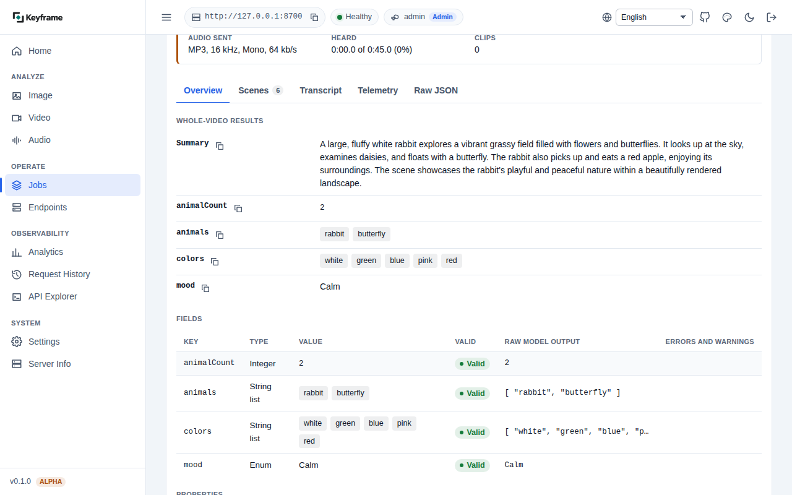

<p align="center">
  
</p>

<p align="center">
  <b>v0.1.0 - ALPHA</b> - API and structure may change without notice
</p>

# Keyframe

Keyframe generates summaries and extracts metadata from images, video, and audio. You post a picture, a clip, or a recording, tell it what you want to know, and it hands back a summary plus a dictionary of typed answers keyed the way you asked. For video it also breaks the footage into scenes, summarizes and answers questions per scene, and can line the results up against a transcript of the audio. For audio it listens: a model hears the recording itself, with a transcript as a hint, so it can tell a live take from a studio one or name the instruments, and ffmpeg measures loudness, levels, silence, and stereo width before any model runs. Every response carries its own telemetry: how long each stage took, every model call made, and the tokens each one used.

This image runs the Keyframe REST server with ffmpeg and ffprobe included. Source, documentation, and the full Docker Compose stack are at [github.com/jchristn/Keyframe](https://github.com/jchristn/Keyframe).

> **Status.** Keyframe is in active development. Model calls go through [PolyPrompt](https://github.com/jchristn/PolyPrompt) 5.0 (Ollama, OpenAI, Azure OpenAI, OpenAI-compatible servers, Anthropic, Gemini, xAI, Cohere). The default settings use Ollama on the Docker host (gemma3:4b, qwen3-vl:8b, gpt-oss:20b), llama-server on the Docker host for listening (Voxtral Mini 3B), and the `keyframe-whisper` speech-to-text service from the Compose stack.

## Use cases

- **Cataloging and search.** Tag photo and video libraries with the fields your application already uses: counts, categories, yes or no questions, lists of objects or colors.
- **Moderation and review queues.** Ask targeted questions of every upload and route on the typed answers.
- **Video indexing.** Get frame-exact scene boundaries from ffmpeg, a summary and fields per scene, and a transcript aligned to the scenes.
- **Audio and music archives.** Ask whether a track is live or a studio take, which instruments play, or whether it has explicit lyrics, answered by a model that heard the audio. Get exact loudness and silence figures, and split long recordings into sections at their silences.
- **Cost and latency tracking.** Every response reports stage timings, per-call latency, attempts, and tokens, and the same signals flow to Prometheus, Tempo, and Grafana.

## Screenshots

**Typed fields from an image.** A photo of a dog gives `animalCount` 1, `animals` [dog], `colors` [yellow, white, green], and `isOutdoors` true, next to a summary.


**Typed fields from a video.** For a clip of Big Buck Bunny, the whole-video results report `animalCount` 2, `animals` [rabbit, butterfly], `colors`, and `mood`, with each value's type and validity.



**Audio results.** The Listening card shows what the model heard and every clip sent; Measurements reports loudness, levels, and silence with no model calls.


The full tour of the dashboard is in the [README on GitHub](https://github.com/jchristn/Keyframe#screenshots).

## Architecture

```text
            request (URL or base64)
                     |
               MediaResolver  ---- SSRF guard, size limits
                     |
               MediaProber    ---- ffprobe: dimensions, duration, codecs, tags
                     |
     +---------------+-----------------+-------------------------+
     |                                 |                         |
  image                              video                     audio
     |                                 |                         |
ImageNormalizer             SceneDetector,            Measure, AudioExtraction,
     |                      FrameExtractor,           Transcribe, SectionDetection,
     |                      AudioExtractor,           ListenExtraction, Sections
     |                      scene audio clips                    |
     |                                 |                         |
     +---------- IInferenceClient -----+------- ITranscriptionClient
     (PolyPrompt, streamed, with images and audio; or mock)
                     |
   Results + Fields + Scenes + Sections + Transcript
        + Measurements + Listening + Telemetry
```

The server is a Watson 7 REST service. It stores request history, analytics, and video and audio jobs in SQLite by default, or in MySQL, PostgreSQL, or SQL Server.

## Getting started

```bash
docker run -d --name keyframe --hostname keyframe-server \
  -p 8700:8700 \
  -v keyframe-data:/app/data \
  jchristn77/keyframe-server:v0.1.0

curl http://127.0.0.1:8700/v1.0/health
```

Analyze an image:

```bash
curl -H "x-api-key: default" -H "Content-Type: application/json" \
  -d '{"Image":{"Url":"https://upload.wikimedia.org/wikipedia/commons/3/3a/Cat03.jpg"},"Functions":{"Summarize":{"Enable":true},"Extract":{"Enable":true,"Fields":[{"Key":"hasCats","Type":"Boolean","Prompt":"Does this image have cats?"}]}}}' \
  http://127.0.0.1:8700/v1.0/image
```

Analyze a recording (an audio job; `Wait` returns the result when it finishes in time):

```bash
curl -H "x-api-key: default" -H "Content-Type: application/json" \
  -d '{"Audio":{"Url":"https://example.com/track07.mp3"},"Wait":true,"Functions":{"Summarize":{"Enable":true},"Extract":{"Enable":true,"Fields":[{"Key":"recording","Type":"Enum","Options":["Live","Studio"],"Prompt":"How was this recorded?"}]}}}' \
  http://127.0.0.1:8700/v1.0/audio
```

Read `Listening.Listened` in the result. `true` means a model heard the audio; `false` means the answers came from the transcript only, and `Listening.Reason` says why (for example `EndpointUnhealthy` while the listening server is stopped or still loading).

The default keys are `default` (access) and `keyframeadmin` (admin). Change both before the server is reachable by anyone else, either in the settings file or with `-e KEYFRAME_ACCESS_KEY=... -e KEYFRAME_ADMIN_API_KEY=...`.

## Configuration

| Path | Purpose |
| --- | --- |
| `/app/config/keyframe.json` | Settings file (`KEYFRAME_SETTINGS_FILE`). The image ships container defaults; mount your own to change endpoints, keys, limits, or the database. |
| `/app/data` | SQLite database. Mount a volume to keep jobs and request history. |
| `/app/temp` | Media working directory. |
| `/app/logs` | Log files. Logs also go to the container console. |

| Port | Purpose |
| --- | --- |
| `8700` | REST API, OpenAPI document at `/openapi.json`, health at `/v1.0/health` |
| `9464` | Prometheus scrape endpoint. It answers requests addressed to `keyframe-server:9464`, so run the container with `--hostname keyframe-server`. Keep it off public interfaces. |

The container runs as the non-root `app` user (uid 1654) and has a built-in healthcheck on `/v1.0/health`. `POST /v1.0/restart` exits the process with code 0, so run it with `--restart unless-stopped` if you use restarts from the dashboard.

## Full stack

The repository's `docker/compose.yaml` brings up the server, the dashboard, the MCP server, the `keyframe-whisper` speech-to-text service, an OpenTelemetry Collector, Prometheus, Tempo, Loki, and Grafana with six provisioned dashboards. Optional profiles add model containers: `ollama`, `listen` (llama-server on CPU), and `listen-gpu` (vLLM on an NVIDIA GPU):

```bash
git clone https://github.com/jchristn/Keyframe.git
cd Keyframe/docker
docker compose up -d --build
```

| Service | URL |
| --- | --- |
| Keyframe server | `http://127.0.0.1:8700` |
| Dashboard | `http://127.0.0.1:8701` |
| MCP server | `http://127.0.0.1:8702` (HTTP), `8703` (TCP), `8704` (WebSocket) |
| Grafana | `http://127.0.0.1:3700` (`admin` / `admin`) |
| Prometheus | `http://127.0.0.1:9700` |
| Tempo | `http://127.0.0.1:3710` |
| Whisper (speaches) | `http://127.0.0.1:8000` |
| llama-server (host, or the `listen` profile) | `http://127.0.0.1:8720` |
| vLLM (`listen-gpu` profile) | `http://127.0.0.1:8730` |

## Listening

The shipped settings listen through llama.cpp's `llama-server` on the Docker host at port 8720, the same way Ollama runs on the host. Start it with:

```bash
llama-server -hf ggml-org/Voxtral-Mini-3B-2507-GGUF:Q4_K_M --port 8720
```

On macOS, `brew install llama.cpp` gives a Metal build, much faster than a container because Docker on Apple Silicon has no Metal access. On Linux, use a release binary or a source build, and add `--host 0.0.0.0` (behind a firewall) so the containers can reach it through the Docker bridge. On Windows, run `llama-server.exe` from a prebuilt release with the same arguments. The first start downloads about 3 to 4 GB once; the CPU model needs 4 to 6 GB of RAM. The image's built-in settings already include this `llama-listen` endpoint at `http://host.docker.internal:8720/v1`; with a plain `docker run` on Linux, add `--add-host host.docker.internal:host-gateway` (the Compose stack does this for you).

To run it in a container instead, use `docker compose --profile listen up -d` (`keyframe-llama`, host port 8720, models in `docker/llama-models`) and stop the host llama-server, or point the `llama-listen` endpoint at `http://keyframe-llama:8080/v1`. On an NVIDIA GPU with about 10 GB of free memory, `docker compose --profile listen-gpu up -d` runs vLLM with Voxtral (`keyframe-vllm`, host port 8730, models in `docker/vllm-models`); activate the shipped `vllm-voxtral` endpoint and set `Inference.DefaultListening` to it. A model container in an active profile is healthy before the server starts (Docker Compose 2.20 or later), so the first start waits for the download. Downloaded models in `docker/ollama-models`, `docker/llama-models`, and `docker/vllm-models` survive restarts, image updates, and factory resets.

Gemini and OpenAI audio models (through an `OpenAiCompatible` endpoint at `https://api.openai.com/v1`) can listen too; uploading a recording to a hosted provider is a rights decision to make first. Without any usable listening endpoint, audio analysis falls back to the transcript and says so in `Listening`. BPM and key are not measured, and lyrics from any model can be wrong.

See [TELEMETRY.md](https://github.com/jchristn/Keyframe/blob/main/TELEMETRY.md) for the metrics, spans, and dashboards, [REST_API.md](https://github.com/jchristn/Keyframe/blob/main/REST_API.md) for the API, and the [README](https://github.com/jchristn/Keyframe#listening-to-audio) for listening setup in detail.

## License

MIT. See [LICENSE.md](https://github.com/jchristn/Keyframe/blob/main/LICENSE.md).
