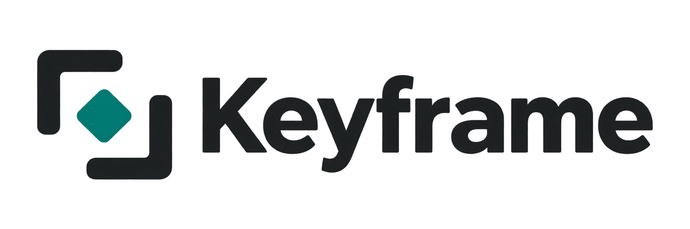

<p align="center">
  
</p>

<p align="center">
  <b>v0.1.0 - ALPHA</b> - API and structure may change without notice
</p>

# Keyframe

Keyframe generates summaries and extracts metadata from images and video. You post a picture or a clip, tell it what you want to know, and it hands back a summary plus a dictionary of typed answers keyed the way you asked. For video it also breaks the footage into scenes, summarizes and answers questions per scene, and can line the results up against a transcript of the audio. Every response carries its own telemetry: how long each stage took, every model call made, and the tokens each one used.

This image runs the Keyframe REST server with ffmpeg and ffprobe included. Source, documentation, and the full Docker Compose stack are at [github.com/jchristn/Keyframe](https://github.com/jchristn/Keyframe).

> **Status.** Keyframe is in active development. Analyses currently run against a deterministic mock model provider. Real providers (Ollama, OpenAI, Anthropic, Gemini, Bedrock, and the rest) arrive through [PolyPrompt](https://github.com/jchristn/PolyPrompt) once its multimedia support lands.

## Use cases

- **Cataloging and search.** Tag photo and video libraries with the fields your application already uses: counts, categories, yes or no questions, lists of objects or colors.
- **Moderation and review queues.** Ask targeted questions of every upload and route on the typed answers.
- **Video indexing.** Get frame-exact scene boundaries from ffmpeg, a summary and fields per scene, and a transcript aligned to the scenes.
- **Cost and latency tracking.** Every response reports stage timings, per-call latency, attempts, and tokens, and the same signals flow to Prometheus, Tempo, and Grafana.

## Architecture

```text
            request (URL or base64)
                     |
               MediaResolver  ---- SSRF guard, size limits
                     |
               MediaProber    ---- ffprobe: dimensions, duration, codecs, tags
                     |
     +---------------+-----------------+
     |                                 |
  image                              video
     |                                 |
ImageNormalizer             SceneDetector, FrameExtractor, AudioExtractor
     |                                 |
     +---------- IInferenceClient -----+---- ITranscriptionClient
                 (PolyPrompt or mock)
                     |
        Results + Fields + Scenes + Telemetry
```

The server is a Watson 7 REST service. It stores request history and video jobs in SQLite by default, or in MySQL, PostgreSQL, or SQL Server.

## Getting started

```bash
docker run -d --name keyframe --hostname keyframe-server \
  -p 8700:8700 \
  -v keyframe-data:/app/data \
  jchristn77/keyframe-server:v0.1.0

curl http://127.0.0.1:8700/v1.0/health
```

Analyze an image:

```bash
curl -H "x-api-key: default" -H "Content-Type: application/json" \
  -d '{"Image":{"Url":"https://upload.wikimedia.org/wikipedia/commons/3/3a/Cat03.jpg"},"Functions":{"Summarize":{"Enable":true},"Extract":{"Enable":true,"Fields":[{"Key":"hasCats","Type":"Boolean","Prompt":"Does this image have cats?"}]}}}' \
  http://127.0.0.1:8700/v1.0/image
```

The default keys are `default` (access) and `keyframeadmin` (admin). Change both before the server is reachable by anyone else, either in the settings file or with `-e KEYFRAME_ACCESS_KEY=... -e KEYFRAME_ADMIN_API_KEY=...`.

## Configuration

| Path | Purpose |
| --- | --- |
| `/app/config/keyframe.json` | Settings file (`KEYFRAME_SETTINGS_FILE`). The image ships container defaults; mount your own to change endpoints, keys, limits, or the database. |
| `/app/data` | SQLite database. Mount a volume to keep jobs and request history. |
| `/app/temp` | Media working directory. |
| `/app/logs` | Log files. Logs also go to the container console. |

| Port | Purpose |
| --- | --- |
| `8700` | REST API, OpenAPI document at `/openapi.json`, health at `/v1.0/health` |
| `9464` | Prometheus scrape endpoint. It answers requests addressed to `keyframe-server:9464`, so run the container with `--hostname keyframe-server`. Keep it off public interfaces. |

The container runs as the non-root `app` user (uid 1654) and has a built-in healthcheck on `/v1.0/health`. `POST /v1.0/restart` exits the process with code 0, so run it with `--restart unless-stopped` if you use restarts from the dashboard.

## Full stack

The repository's `docker/compose.yaml` brings up the server, the dashboard, the MCP server, an OpenTelemetry Collector, Prometheus, Tempo, Loki, and Grafana with six provisioned dashboards, plus an optional Ollama service:

```bash
git clone https://github.com/jchristn/Keyframe.git
cd Keyframe/docker
docker compose up -d --build
```

| Service | URL |
| --- | --- |
| Keyframe server | `http://127.0.0.1:8700` |
| Dashboard | `http://127.0.0.1:8701` |
| MCP server | `http://127.0.0.1:8702` (HTTP), `8703` (TCP), `8704` (WebSocket) |
| Grafana | `http://127.0.0.1:3700` (`admin` / `admin`) |
| Prometheus | `http://127.0.0.1:9700` |
| Tempo | `http://127.0.0.1:3710` |

See [TELEMETRY.md](https://github.com/jchristn/Keyframe/blob/main/TELEMETRY.md) for the metrics, spans, and dashboards, and [REST_API.md](https://github.com/jchristn/Keyframe/blob/main/REST_API.md) for the API.

## License

MIT. See [LICENSE.md](https://github.com/jchristn/Keyframe/blob/main/LICENSE.md).
