<p align="center">
  
</p>

<p align="center">
  <b>v0.1.0 - ALPHA</b> - API and structure may change without notice
</p>

# Keyframe

Keyframe generates summaries and extracts metadata from images, video, and audio. You post a picture, a clip, or a recording, tell it what you want to know, and it hands back a summary plus a dictionary of typed answers keyed the way you asked. For video it also breaks the footage into scenes, summarizes and answers questions per scene, and can line the results up against a transcript of the audio. For audio it listens: a model hears the recording itself, with a timestamped transcript as a hint, so it can tell a live take from a studio one or name the instruments on an instrumental track. ffmpeg measures loudness, levels, silence, and stereo width before any model runs, and a long recording can be split into sections at its silences. Any scene, section, or transcript segment can be cut back out of the source as a clip, an audio file, or a still. Every response carries its own telemetry (how long each stage took, every model call made, time to first token, generation speed, and tokens), and every analysis is kept for an analytics API with percentiles over time.

> **Status.** Keyframe is in active development. The media pipeline, analysis engine, persistence on four databases, and the REST server are built and tested. Model calls go through [PolyPrompt](https://github.com/jchristn/PolyPrompt) 5.0 (Ollama, OpenAI, Azure OpenAI, OpenAI-compatible servers, Anthropic, Gemini, xAI, Cohere), with a deterministic mock provider for tests. The shipped defaults use local Ollama models, a local Whisper server, and a local llama-server that listens to audio. See [AUDIO_ENHANCEMENTS_PLAN.md](AUDIO_ENHANCEMENTS_PLAN.md) for the current plan and progress.

## Why Keyframe

Most media metadata work ends up as a pile of one-off scripts: something to pull frames, something to call a vision model, something to coax the answer into JSON, and nothing that tells you what it cost. Keyframe puts that behind one API with one request shape.

- **Ask for exactly what you need.** Define fields with a key, a type (`Boolean`, `String`, `Integer`, `Number`, `Enum`, `StringList`, `Object`), and a prompt. Keyframe returns values coerced to those types, with per-field validity and warnings when it had to clamp or truncate.
- **Video without the plumbing.** Scene boundaries come from ffmpeg, so they are exact to the frame. Models describe what is in each scene; they are never trusted to decide where a cut is.
- **Audio is heard, not only transcribed.** A transcript cannot tell you whether a track is live, which instruments play, or anything at all about an instrumental. Keyframe sends the audio itself to a listening model, keeps the transcript as a hint the model is told to overrule, and says in every response whether the audio was actually heard (`Listening.Listened`) or the answer came from the transcript.
- **Cheap work first.** Media properties, scene detection, frame extraction, audio measurements, and section detection are deterministic and run before any model is called. Model calls happen only for the functions you enable.
- **See where the time and tokens went.** Stage timings, per-call latency, attempts, and token counts come back in every response, and the same signals flow to Prometheus, Tempo, and Grafana.

## Screenshots

<details>
<summary>Click to expand a tour of the dashboard.</summary>

<br />

**Typed fields from an image.** Ask questions as fields and get typed answers back. Here a photo of a dog gives `animalCount` 1 (Integer), `animals` [dog] and `colors` [yellow, white, green] (string lists), and `isOutdoors` true (Boolean), next to a summary.

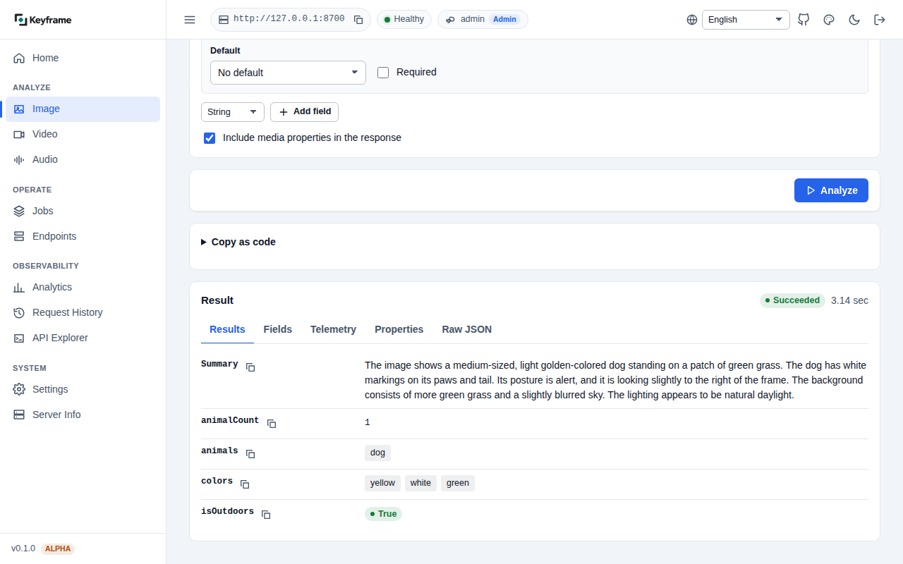

**Typed fields from a video.** The same fields work on video. For a 45-second clip of Big Buck Bunny, the whole-video results report `animalCount` 2, `animals` [rabbit, butterfly], `colors` [white, green, blue, pink, red], and `mood` Calm (Enum), and the Fields table shows each value's type, validity, and the raw model output.

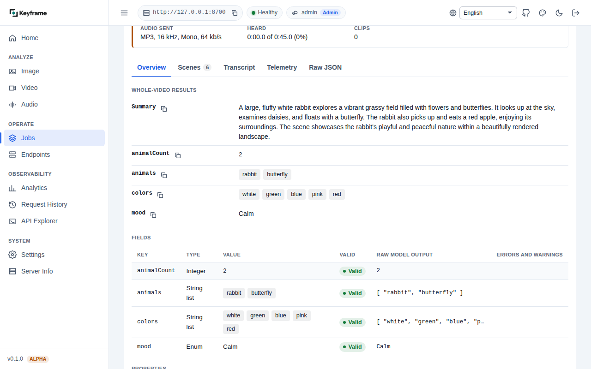

**Scenes.** Scene boundaries come from ffmpeg cuts, with keyframes per scene and per-scene summaries and fields. The Listening card states plainly when the vision model could not hear the scene audio.

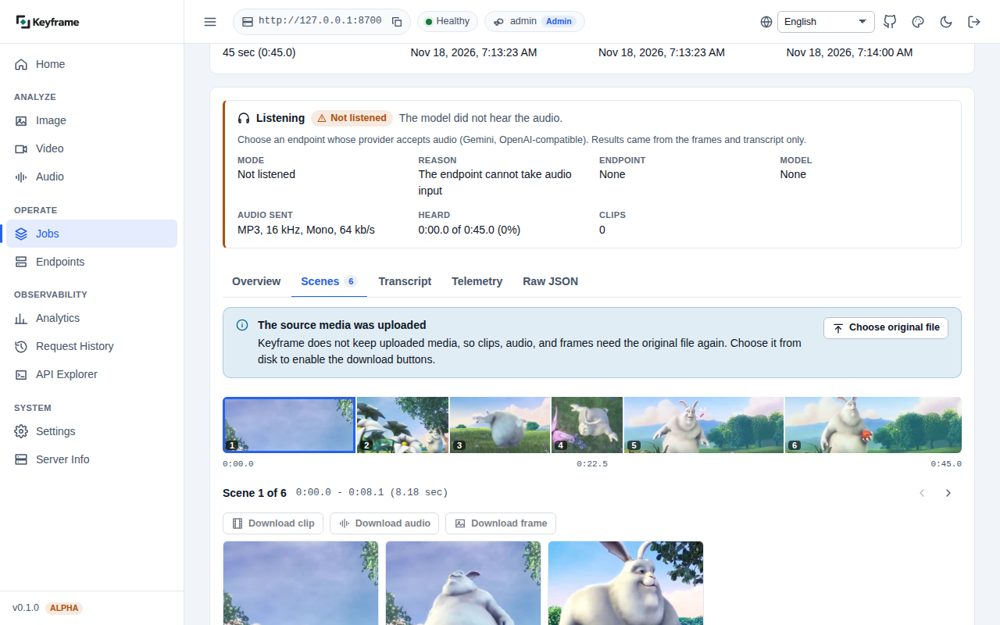

**Home.** The landing page shows request volume, success rate, latency, active jobs, endpoint health, and a request activity chart.

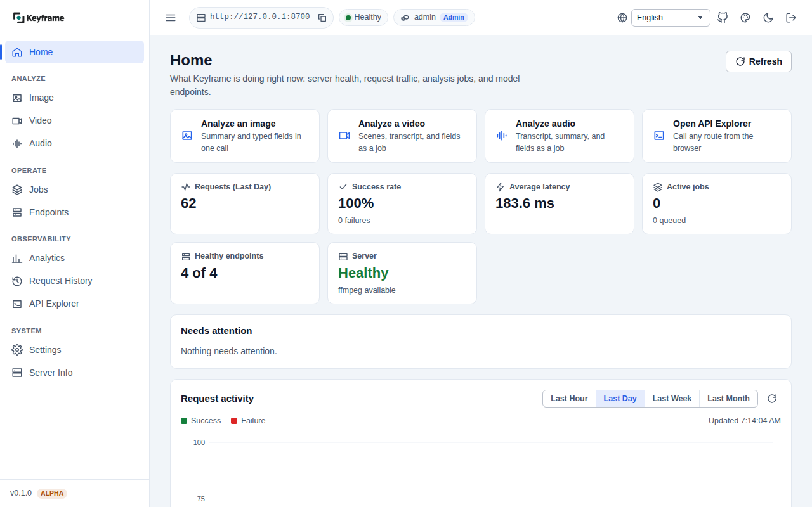

**Analyze audio.** Listening is on by default: pick the listening endpoint, see its health, and tune excerpts and audio quality.

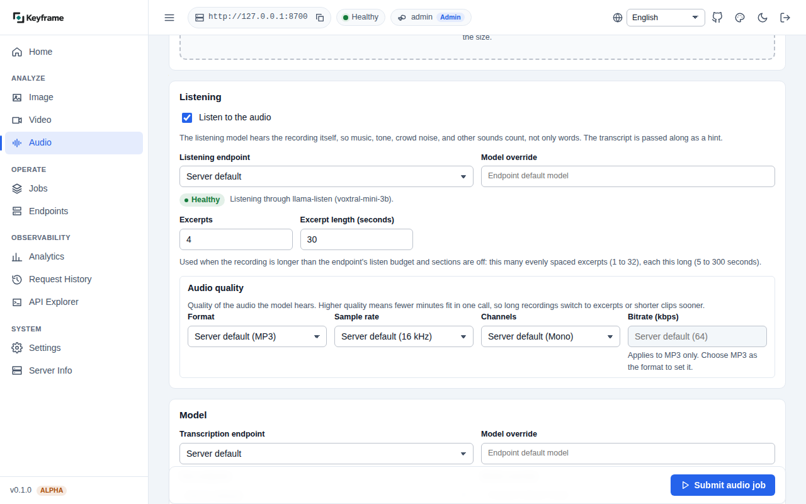

**Audio results.** The Listening card shows what the model heard and every clip sent; Measurements reports loudness, levels, and silence with no model calls.

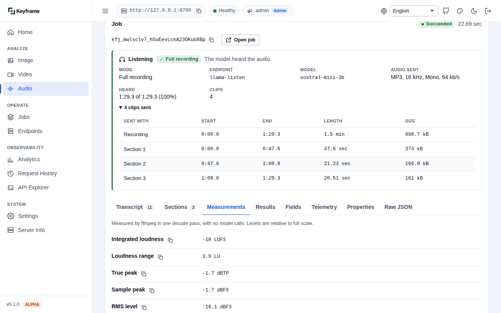

**Sections.** The recording is split at silences. Each section heard its own clip, has its own results and transcript slice, and can be downloaded.

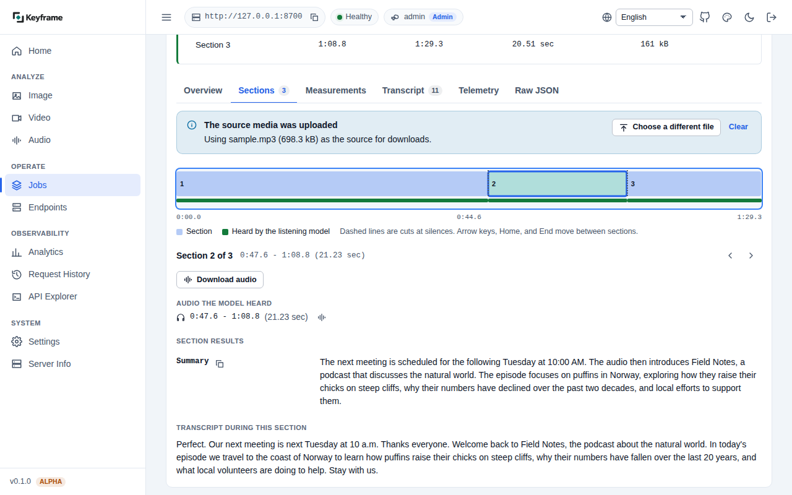

**Endpoints.** Capability badges show which endpoints take images, transcribe, or listen to audio, next to live health.

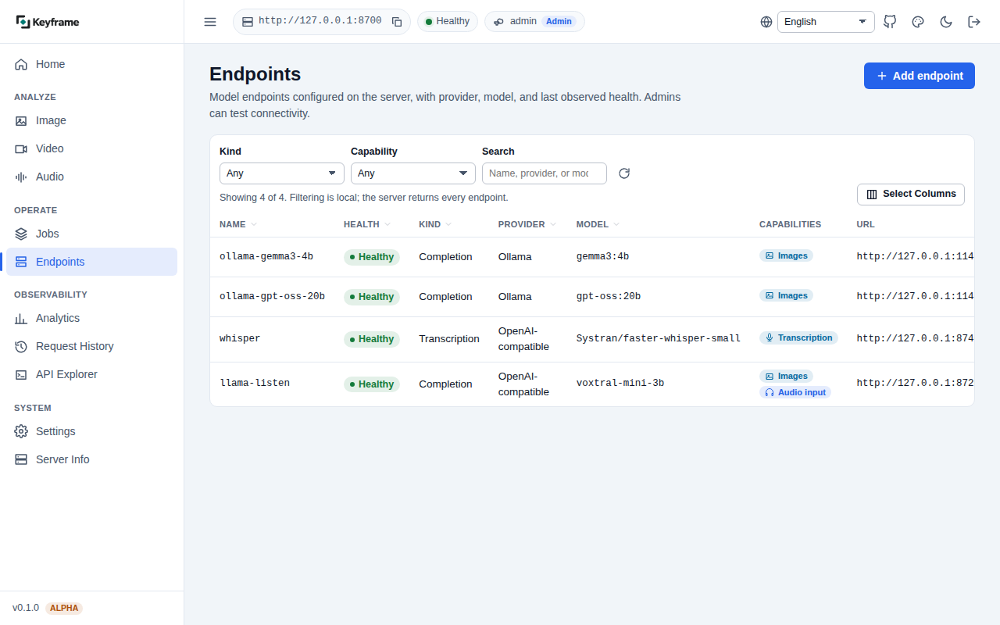

**Analytics.** Latency percentiles, tokens, and call breakdowns over time, stored on SQLite, MySQL, PostgreSQL, or SQL Server.

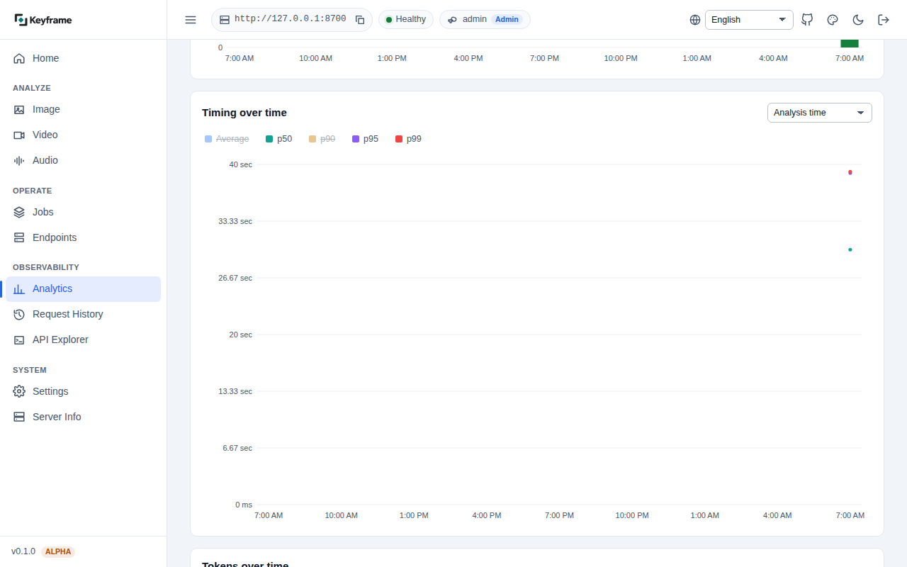

**Request history.** Every request is captured with redacted headers; the inspector shows metadata, headers, and bodies.

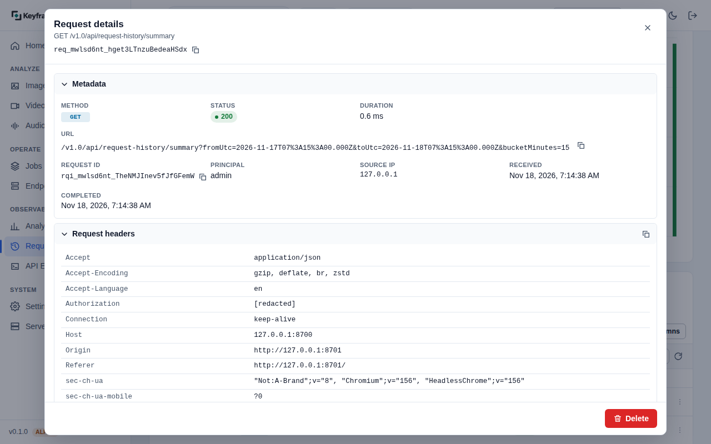

**Settings.** Settings are typed, clamped, and marked Live or Restart; the Media group holds the listening and measurement defaults.

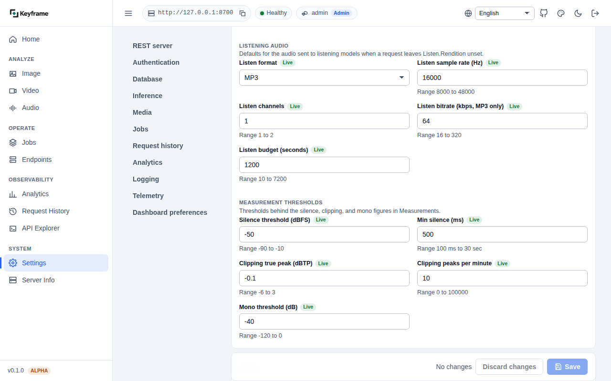

Captured against a local stack: Ollama `gemma3:4b` and `gpt-oss:20b` for vision and text, Whisper `faster-whisper-small` for transcription, and Voxtral Mini 3B on llama-server for listening. Media credits: the dog photo is [YellowLabradorLooking_new.jpg](https://commons.wikimedia.org/wiki/File:YellowLabradorLooking_new.jpg) (derivative work by Djmirko, CC BY-SA 3.0), and the video is from [Big Buck Bunny](https://peach.blender.org/) ((c) Blender Foundation, CC BY 3.0); both are in `test-data`.

</details>

## Example

```json
POST /v1.0/image
{
  "Image": { "Url": "https://example.com/backyard.jpg" },
  "Context": [
    { "Label": "Source", "Text": "Photos submitted by pet adoption volunteers." },
    { "Label": "Location", "Text": "Shelter intake yard." }
  ],
  "Functions": {
    "Summarize": { "Enable": true, "Key": "Summary", "MaxWords": 60 },
    "Extract": {
      "Enable": true,
      "Fields": [
        { "Key": "hasCats", "Type": "Boolean", "Prompt": "Does this image have cats?" },
        { "Key": "dogCount", "Type": "Integer", "Prompt": "How many dogs do you see in this image?" }
      ]
    }
  }
}
```

Every `Context` item is included in every prompt the request produces, so background you supply once applies to the summary and to each field. The response includes `Results` (`{ "Summary": "...", "hasCats": false, "dogCount": 2 }`), a `Fields` array with per-field detail, the media `Properties`, and `Telemetry`. Video requests (`POST /v1.0/video`) add `Scenes` and `Transcribe` functions. Audio requests (`POST /v1.0/audio`) listen to the recording, transcribe it, measure it, and optionally split it into sections, then summarize and extract (see [Listening to audio](#listening-to-audio)). Both run as background jobs. The full contract is in [REST_API.md](REST_API.md).

## Architecture

```text
            request (URL or base64)
                     |
               MediaResolver  ---- SSRF guard, size limits
                     |
               MediaProber    ---- ffprobe: dimensions, duration, codecs, tags
                     |
     +---------------+-----------------+-------------------------+
     |                                 |                         |
  image                              video                     audio
     |                                 |                         |
ImageNormalizer             SceneDetector,            Measure (AudioMeasurer)
     |                      FrameExtractor,           AudioExtraction, Transcribe
     |                      AudioExtractor,           SectionDetection (SectionDetector)
     |                      scene audio clips         ListenExtraction (listening clips)
     |                                 |              Sections (per-section functions)
     |                                 |                         |
     +---------- IInferenceClient -----+------- ITranscriptionClient
     (PolyPrompt, streamed, with images and audio; or mock)
                     |
   Results + Fields + Scenes + Sections + Transcript
        + Measurements + Listening + Telemetry
                     |
        analytics rows (analyses, modelcalls)
```

An audio job runs its stages in this order, each only when its function is on: `Resolve`, `Probe`, `Measure`, `AudioExtraction`, `Transcribe`, `SectionDetection`, `ListenExtraction`, `Sections`, then `Summarize` and `Extract` (or a reduce from the section results).

| Project | Purpose |
|---|---|
| `src/Keyframe.Core` | Contracts, media pipeline, inference seam, analysis engine, persistence, metrics and spans |
| `src/Keyframe.Server` | Watson 7 REST server, authentication, jobs, request history, settings API |
| `src/Keyframe.McpServer` | MCP server on Voltaic that exposes Keyframe to agents ([MCP_API.md](MCP_API.md)) |
| `src/Test.*` | Touchstone suites shared by the automated, xUnit, and NUnit runners |
| `dashboard/` | React dashboard on port 8701 ([dashboard/README.md](dashboard/README.md)) |
| `sdk/` | C#, JavaScript, and Python SDKs, each with a test harness |
| `docker/` | Compose stack with Prometheus, Tempo, Loki, and Grafana ([TELEMETRY.md](TELEMETRY.md)) |

## Getting started

Keyframe needs the .NET 10 SDK and ffmpeg (with ffprobe) on the PATH.

```bash
git clone https://github.com/jchristn/Keyframe.git
cd Keyframe
dotnet build src/Keyframe.sln -c Release
dotnet run --project src/Test.Automated -c Release
```

Run the server. It reads the shipped `keyframe.json` (or creates one with defaults when it is missing), listens on `http://127.0.0.1:8700`, and stores data in SQLite under `data/`. The default endpoints (see [Default settings](#default-settings)) expect Ollama on `127.0.0.1:11434`, a Whisper server on `127.0.0.1:8000`, and a listening llama-server on `127.0.0.1:8720`; the server starts either way and reports unreachable endpoints as unhealthy. Without the llama-server, audio analysis falls back to the transcript and says so.

```bash
ollama pull gemma3:4b && ollama pull qwen3-vl:8b && ollama pull gpt-oss:20b

# Speech to text (speaches, OpenAI-compatible). It does not download models on its own:
docker run -d --name keyframe-whisper -p 127.0.0.1:8000:8000 -e ENABLE_UI=false \
  -v whisper-models:/home/ubuntu/.cache/huggingface/hub ghcr.io/speaches-ai/speaches:0.8.3-cpu
curl -X POST http://127.0.0.1:8000/v1/models/Systran/faster-whisper-small

# Listening (optional; see "Listening to audio"). Downloads 3 to 4 GB once.
llama-server -hf ggml-org/Voxtral-Mini-3B-2507-GGUF:Q4_K_M --port 8720

cd src/Keyframe.Server
dotnet run -c Release
```

Then try it:

```bash
curl http://127.0.0.1:8700/v1.0/health
curl -H "x-api-key: default" -H "Content-Type: application/json" \
  -d '{"Image":{"Url":"https://upload.wikimedia.org/wikipedia/commons/3/3a/Cat03.jpg"},"Functions":{"Summarize":{"Enable":true}}}' \
  http://127.0.0.1:8700/v1.0/image
```

The default keys are `default` (access) and `keyframeadmin` (admin). Change both before the server is reachable by anyone else, or set `KEYFRAME_ACCESS_KEY` and `KEYFRAME_ADMIN_API_KEY`. The full API is in [REST_API.md](REST_API.md), the live OpenAPI document is at `/openapi.json`, and a Postman collection is in [assets/postman](assets/postman/Keyframe.postman_collection.json).

## API overview

Every route, grouped as in [REST_API.md](REST_API.md#contents). Auth is `none` (anonymous), `key` (any access key or the admin key), or `admin` (the admin key only).

| Group | Method | Path | Auth | Purpose |
|---|---|---|---|---|
| [System](REST_API.md#system) | `HEAD`, `GET` | [`/`](REST_API.md#get-) | none | Liveness and the root page |
| | `GET` | [`/favicon.ico`](REST_API.md#get-faviconico) | none | Favicon |
| | `GET` | [`/v1.0/health`](REST_API.md#get-v10health) | none | Version, uptime, ffmpeg, database, endpoint health |
| | `GET` | [`/v1.0/whoami`](REST_API.md#get-v10whoami) | key | The key you are using and whether it is admin |
| [Analysis](REST_API.md#analysis) | `POST` | [`/v1.0/image`](REST_API.md#post-v10image) | key | Summarize an image and extract typed fields (synchronous) |
| | `POST` | [`/v1.0/video`](REST_API.md#post-v10video) | key | Queue a video job: scenes, transcript, summaries, fields |
| | `POST` | [`/v1.0/audio`](REST_API.md#post-v10audio) | key | Queue an audio job: listening, transcript, measurements, sections, summary, fields |
| | `POST` | [`/v1.0/probe`](REST_API.md#post-v10probe) | key | Media properties from ffprobe, no model calls |
| [Segments](REST_API.md#segments) | `POST` | [`/v1.0/segment`](REST_API.md#post-v10segment) | key | Cut a video clip, audio clip, or frame out of a source |
| [Jobs](REST_API.md#jobs) | `GET` | [`/v1.0/jobs`](REST_API.md#get-v10jobs) | key | List jobs with filters and paging |
| | `GET` | [`/v1.0/jobs/{id}`](REST_API.md#get-v10jobsid) | key | Job status and progress |
| | `GET` | [`/v1.0/jobs/{id}/result`](REST_API.md#get-v10jobsidresult) | key | The finished video or audio result |
| | `POST` | [`/v1.0/jobs/{id}/cancel`](REST_API.md#post-v10jobsidcancel) | key | Cancel a queued or running job |
| | `DELETE` | [`/v1.0/jobs/{id}`](REST_API.md#delete-v10jobsid) | key | Delete a finished job and its result |
| [Endpoints](REST_API.md#endpoints) | `GET` | [`/v1.0/endpoints`](REST_API.md#get-v10endpoints) | key | Configured model endpoints with capabilities and health |
| | `POST` | [`/v1.0/endpoints/{name}/test`](REST_API.md#post-v10endpointsnametest) | admin | Probe one endpoint now |
| [Analytics](REST_API.md#analytics) | `GET` | [`/v1.0/analytics/summary`](REST_API.md#get-v10analyticssummary) | admin | Percentiles, gap-filled buckets, by media kind, model, stage, purpose |
| | `GET` | [`/v1.0/analytics/analyses`](REST_API.md#get-v10analyticsanalyses) | admin | Stored analyses, newest first |
| | `GET` | [`/v1.0/analytics/analyses/{id}`](REST_API.md#get-v10analyticsanalysesid) | admin | One analysis with every model call attempt |
| | `DELETE` | [`/v1.0/analytics/analyses/{id}`](REST_API.md#delete-v10analyticsanalysesid) | admin | Delete one analysis |
| | `DELETE` | [`/v1.0/analytics/analyses`](REST_API.md#delete-v10analyticsanalyses) | admin | Delete analyses older than a cutoff |
| [Settings](REST_API.md#settings) | `GET` | [`/v1.0/settings`](REST_API.md#get-v10settings) | admin | Settings with secrets masked, plus field metadata |
| | `PUT` | [`/v1.0/settings`](REST_API.md#put-v10settings) | admin | Validate, save, and apply settings |
| | `POST` | [`/v1.0/restart`](REST_API.md#post-v10restart) | admin | Exit cleanly so the container restarts |
| [Request history](REST_API.md#request-history) | `GET` | [`/v1.0/api/request-history`](REST_API.md#get-v10apirequest-history) | key | Captured requests, newest first |
| | `GET` | [`/v1.0/api/request-history/summary`](REST_API.md#get-v10apirequest-historysummary) | key | Bucketed success and failure counts |
| | `GET` | [`/v1.0/api/request-history/{id}`](REST_API.md#get-v10apirequest-historyid) | key | One request with headers and bodies |
| | `DELETE` | [`/v1.0/api/request-history/{id}`](REST_API.md#delete-v10apirequest-historyid) | admin | Delete one entry |
| | `DELETE` | [`/v1.0/api/request-history`](REST_API.md#delete-v10apirequest-history) | admin | Delete entries matching a filter |

The request and response types are listed under [Shared types](REST_API.md#shared-types). The OpenAPI document at `/openapi.json` is generated from the same route metadata.

### Retrieving segments of audio and video

Analysis results carry exact time ranges: `Scenes[i].StartMs` and `EndMs` for video, `Sections[i].StartMs` and `EndMs` for audio, and `Transcript.Segments[i].StartMs` and `EndMs` for video and audio. `POST /v1.0/segment` cuts that range back out of the source as a video clip (`Video`), its audio (`Audio`), or a still frame at `StartMs` (`Frame`). Keyframe does not keep uploaded media, so send the same `Source` again: the same `Url`, or the same base64 `Data`.

1. Analyze the media and wait for the result.

   ```bash
   curl -s -X POST http://127.0.0.1:8700/v1.0/video \
     -H "x-api-key: default" -H "Content-Type: application/json" \
     -d '{ "Video": { "Url": "https://example.com/talk.mp4" }, "Wait": true,
           "Functions": { "Scenes": { "Enable": true, "Summarize": { "Enable": true } }, "Transcribe": { "Enable": true } } }' \
     -o result.json
   ```

   For a recording, use `POST /v1.0/audio` with `{ "Audio": { "Url": "https://example.com/standup.mp3" }, "Wait": true }`.

2. Read a range from the result, for example with jq.

   ```bash
   jq '.Scenes[2] | { StartMs, EndMs }' result.json               # { "StartMs": 12000, "EndMs": 18500 }
   jq '.Transcript.Segments[5] | { StartMs, EndMs, Text }' result.json
   ```

3. Fetch the segment. The binary form writes the media straight to a file; the response also carries `Content-Disposition` and `x-keyframe-segment-start-ms`, `-end-ms`, and `-duration-ms` headers (an `EndMs` past the end is clamped).

   ```bash
   # The scene as an mp4 clip, scaled to 720 pixels on the long edge
   curl -s -X POST http://127.0.0.1:8700/v1.0/segment \
     -H "x-api-key: default" -H "Content-Type: application/json" \
     -d '{ "Source": { "Url": "https://example.com/talk.mp4" }, "StartMs": 12000, "EndMs": 18500, "Output": "Video", "MaxEdge": 720 }' \
     -o scene-3.mp4

   # What was said in that transcript segment, as mp3
   curl -s -X POST http://127.0.0.1:8700/v1.0/segment \
     -H "x-api-key: default" -H "Content-Type: application/json" \
     -d '{ "Source": { "Url": "https://example.com/talk.mp4" }, "StartMs": 41200, "EndMs": 47900, "Output": "Audio", "Format": "mp3" }' \
     -o segment-5.mp3

   # A still from the start of the scene, returned as JSON with base64 data
   curl -s -X POST http://127.0.0.1:8700/v1.0/segment \
     -H "x-api-key: default" -H "Content-Type: application/json" \
     -d '{ "Source": { "Url": "https://example.com/talk.mp4" }, "StartMs": 12000, "Output": "Frame", "ResponseFormat": "Json" }' \
     | jq '{ MediaType, Filename, SizeBytes }'
   ```

   With base64 input, put the same `Data` in `Source` (`{ "Source": { "Data": "AAAAIGZ0eXBpc29t..." }, ... }`). Audio files support `Output: "Audio"` only; `Video` and `Frame` need a video source. Segments are limited to `Media.MaxSegmentMs` (10 minutes by default).

## Model providers

Endpoints live in `Inference.Endpoints` in `keyframe.json` (or the dashboard's Settings page). `DefaultVision` names the completion endpoint used for images and frames, `DefaultListening` names the completion endpoint that hears audio, `DefaultText` names the text-only endpoint for audio summaries and fields when the audio is not heard (and for the optional text-only whole-video step and section reduce), and `DefaultTranscription` names the speech-to-text endpoint. Completion calls stream, so every call reports time to first token, generation time, and tokens per second.

### Default settings

The shipped `keyframe.json` files (`src/Keyframe.Server/keyframe.json`, `docker/keyframe.json`, `docker/factory/keyframe.json`) contain these endpoints. `vllm-voxtral` is only in the two Docker files. A settings file the server creates from scratch has the first four and no listening endpoint (`DefaultListening` null), so its audio requests fall back to the transcript until you add one. There is no mock endpoint by default; tests and offline demos add one with `"Provider": "Mock"`.

| Name | Provider | Kind | Endpoint (local / Docker) | Model |
|---|---|---|---|---|
| `ollama-gemma3-4b` | `Ollama` | Completion, vision (`DefaultVision`) | `http://127.0.0.1:11434` / `http://host.docker.internal:11434` | `gemma3:4b` |
| `ollama-qwen3-vl-8b` | `Ollama` | Completion, vision | same | `qwen3-vl:8b` |
| `ollama-gpt-oss-20b` | `Ollama` | Completion, text (`DefaultText`) | same | `gpt-oss:20b` |
| `whisper` | `OpenAiCompatible` | Transcription (`DefaultTranscription`) | `http://127.0.0.1:8000/v1` / `http://keyframe-whisper:8000/v1` | `Systran/faster-whisper-small` |
| `llama-listen` | `OpenAiCompatible` | Completion, listening (`DefaultListening`) | `http://127.0.0.1:8720/v1` / `http://host.docker.internal:8720/v1` | `voxtral-mini-3b` |
| `vllm-voxtral` | `OpenAiCompatible` | Completion, listening, inactive | Docker only: `http://keyframe-vllm:8000/v1` | `mistralai/Voxtral-Mini-3B-2507` |

The Ollama endpoints use `MaxOutputTokens` 4096 and `TimeoutMs` 300000, because reasoning models such as gpt-oss spend output tokens thinking. `llama-listen` uses `MaxConcurrentRequests` 1, `TimeoutMs` 600000, and `MaxListenSeconds` 120, sized for a small model on a CPU. Analytics are on (`Analytics.Enable`, 90 days of `Analytics.RetentionDays`), and segments are limited to 10 minutes (`Media.MaxSegmentMs`).

### Providers

| Provider | `Endpoint` | `ApiKey` | Images | Audio input | Native JSON output | Transcription |
|---|---|---|---|---|---|---|
| `Ollama` | Optional (default `http://127.0.0.1:11434`) | Optional | Yes | No | No | No |
| `OllamaCloud` | Optional | Required | Yes | No | No | No |
| `OpenAi` | Optional | Required | Yes | No | Yes | Yes (`whisper-1` returns timed segments) |
| `AzureOpenAi` | Required | Required | Yes | No | Yes | Yes |
| `OpenAiCompatible` | Required (for example `http://127.0.0.1:8000/v1`) | Optional | Yes | Yes (mp3 and wav) | No | Yes, if the server has `/v1/audio/transcriptions` |
| `Anthropic` | Optional | Required | Yes | No | No | No |
| `Gemini` | Optional | Required | Yes | Yes | No | No |
| `XAi` | Optional | Required | Yes | No | Yes | No |
| `Cohere` | Optional | Required | Yes | No | No | No |
| `VertexAi`, `Bedrock` | Not yet supported: they need credential settings Keyframe does not have yet | | | | | |

"Images: Yes" means the provider accepts images; the model you name must be a vision model. "Audio input: Yes" means a completion endpoint on that provider can listen (the `Mock` provider can too); the model you name must understand audio. The `OpenAi` and `AzureOpenAi` providers use the Responses API clients, which take no audio, so OpenAI's audio models are reached through an `OpenAiCompatible` endpoint at `https://api.openai.com/v1` (see [Listening to audio](#listening-to-audio)). Where native JSON output is not available, extraction describes the schema in the prompt and parses the reply leniently, with one repair attempt. `GET /v1.0/endpoints` reports `ProviderAvailable`, `SupportsImages`, `SupportsAudioInput`, `SupportsStructuredOutput`, and `SupportsTranscription` for each endpoint.

Example: switch the default vision model to the larger Qwen model and add a hosted text model.

```json
"Inference": {
  "DefaultVision": "ollama-qwen3-vl-8b",
  "DefaultText": "openai-text",
  "Endpoints": [
    { "Name": "ollama-qwen3-vl-8b", "Provider": "Ollama", "Kind": "Completion", "Endpoint": "http://127.0.0.1:11434", "Model": "qwen3-vl:8b", "MaxOutputTokens": 4096, "TimeoutMs": 300000, "Active": true },
    { "Name": "openai-text", "Provider": "OpenAi", "Kind": "Completion", "ApiKey": "sk-...", "Model": "gpt-4.1-mini", "Active": true }
  ]
}
```

Reasoning models spend output tokens on thinking, so give them a generous `MaxOutputTokens`.

## Listening to audio

A transcript is a poor stand-in for a recording. It holds the words, and for a meeting the words are most of what matters. For music it falls apart: an instrumental produces an empty transcript, and "is this live or a studio take" gets answered from stage banter if there is any and guessed if there is not. So `POST /v1.0/audio` sends the audio itself to a listening model by default (`Listen.Enable`, on unless you turn it off), with the Whisper transcript attached as a hint the model is told to overrule when the two disagree.

```bash
curl -X POST http://127.0.0.1:8700/v1.0/audio \
  -H "x-api-key: default" -H "Content-Type: application/json" \
  -d '{
    "Audio": { "Url": "https://example.com/track07.mp3" },
    "Wait": true, "WaitTimeoutMs": 600000,
    "Listen": { "Enable": true, "Model": { "Endpoint": "llama-listen" } },
    "Context": [ { "Label": "Artist", "Text": "Archive of a touring rock band, 1978 to 1994." } ],
    "Functions": {
      "Transcribe": { "Enable": true },
      "Summarize": { "Enable": true, "MaxWords": 80 },
      "Extract": { "Enable": true, "Fields": [
        { "Key": "chorusLyrics", "Type": "String", "Prompt": "Lyrics of the chorus." },
        { "Key": "recording", "Type": "Enum", "Options": [ "Live", "Studio", "Rehearsal", "Demo" ], "Prompt": "How was this recorded?" },
        { "Key": "explicit", "Type": "Boolean", "Prompt": "Does it contain profanity?" },
        { "Key": "instruments", "Type": "StringList", "Prompt": "Instruments you can hear." }
      ] }
    }
  }'
```

The result has the usual `Transcript`, `Results`, and `Fields`, plus two new objects. `Measurements` comes from ffmpeg before any model is called: integrated loudness, loudness range, true peak, peak and RMS level, crest factor, a `ClippingLikely` flag with its raw inputs, silence ratio and leading and trailing silence, and stereo width with an `EffectivelyMono` flag. `Listening` says what the model heard:

```json
"Listening": {
  "Listened": true, "Mode": "Excerpts", "Reason": null,
  "Endpoint": "llama-listen", "Model": "voxtral-mini-3b",
  "Rendition": { "Format": "Mp3", "SampleRate": 16000, "Channels": 1, "BitrateKbps": 64 },
  "DurationMs": 241000, "HeardMs": 120000,
  "Clips": [
    { "Scope": "Recording", "Index": null, "StartMs": 0, "EndMs": 30000, "SizeBytes": 241005 },
    { "Scope": "Recording", "Index": null, "StartMs": 70333, "EndMs": 100333, "SizeBytes": 241005 },
    { "Scope": "Recording", "Index": null, "StartMs": 140666, "EndMs": 170666, "SizeBytes": 241005 },
    { "Scope": "Recording", "Index": null, "StartMs": 211000, "EndMs": 241000, "SizeBytes": 241005 }
  ]
}
```

That track is four minutes long and `llama-listen` has a 120-second listen budget, so the model heard four evenly spaced 30-second excerpts and the response carries the warning `Listened to 4 excerpts (2m00s) of a 4m01s recording.` A Gemini or vLLM endpoint with the default 1200-second budget hears the same track whole (`Mode: "Full"`, one clip). With `Functions.Sections` on, the recording is split at its silences, each section is heard on its own, and with a `TextModel` set the whole-recording answers are reduced from the section results (`Mode: "Sections"`). The other options (the rendition sent to the model, the number and length of excerpts, the section detection thresholds) are in [REST_API.md](REST_API.md#post-v10audio).

### Reading `Listening`

Check `Listening.Listened` before trusting any answer about how a recording sounds. When no audio-capable endpoint is usable, the request still runs, on the transcript with the text model, exactly as audio analysis did before listening existed, and the response says so. `Listened` is `false`, `Mode` is `None`, `Reason` carries a stable code, and a warning is added for the codes that mean something went wrong:

| `Reason` | What happened | Warning |
|---|---|---|
| `NotRequested` | The request sent `"Listen": { "Enable": false }` | no |
| `NoModelFunctions` | Nothing needed the audio (for example a transcribe-only or measure-only request) | no |
| `NoEndpointConfigured` | No `Listen.Model`, and `Inference.DefaultListening` is unset or inactive | yes |
| `EndpointLacksAudioInput` | The default listening endpoint's provider cannot take audio | yes |
| `EndpointUnhealthy` | The listening endpoint was unhealthy when the job started, for example a llama-server that is stopped or still loading | yes |
| `NoAudioTrack` | Video scene audio only: the video has no audio track | no |

Listening is decided when the job starts, not when it is submitted, so a queued job uses current health. Unhealthy endpoints are probed again every 15 seconds (`Inference.UnhealthyProbeIntervalMs`), so a listening server that comes back is used again within about that long. A call that cannot reach the listening server at all marks it unhealthy at once, so when the server stops, only the first job that tries it reports the failed call in `Errors`; later jobs fall back until it answers a probe again. `Mode` tells you how much was heard: `Full` is the whole recording, `Excerpts` means parts of it (listed in `Clips`, with `HeardMs` next to `DurationMs`), and `Sections` means each section heard its own clip. A listening call that fails mid-job is reported as an error in `Errors`, not silently retried on the transcript.

A few requests are refused with `400` before they become jobs: a `Listen.Model` that names an endpoint which cannot take audio (or is missing, inactive, or not a completion endpoint), a `Flac` rendition aimed at an `OpenAiCompatible` endpoint (OpenAI and llama-server take only mp3 and wav), and a request with Transcribe off whose listening would fall back, because it would have no evidence at all. Video scenes hear their own audio too (`Scenes.Audio.Enable`, on by default) when the vision endpoint can take audio, and report the outcome in the video result's `Listening`; scene audio never causes a `400`.

### The local listening server

The shipped settings listen through llama.cpp's `llama-server` on the host, the same way Ollama runs on the host, at port 8720. The default model is Voxtral Mini 3B (`ggml-org/Voxtral-Mini-3B-2507-GGUF`, Apache 2.0, quantized to Q4_K_M):

```bash
llama-server -hf ggml-org/Voxtral-Mini-3B-2507-GGUF:Q4_K_M --port 8720
```

- **macOS.** `brew install llama.cpp`. The Homebrew build uses Metal, which matters: Docker on Apple Silicon has no Metal access, so a host llama-server is far faster than the container.
- **Linux.** Install a prebuilt binary from the [llama.cpp releases](https://github.com/ggml-org/llama.cpp/releases), Homebrew, or a source build. A server for the Docker stack must listen on an address the Docker bridge can reach, because the containers arrive through `host.docker.internal` (the bridge gateway), not loopback. Add `--host 0.0.0.0` and keep port 8720 closed to everything but the bridge with your firewall. Ollama on a Linux host has the same caveat.
- **Windows.** Download a prebuilt Windows build from the same releases page and run `llama-server.exe` with the same arguments.

The first start downloads the model and its audio projector, about 3 to 4 GB, into llama-server's cache directory (set `LLAMA_CACHE` to choose it); later starts load them from disk. Plan on 4 to 6 GB of RAM for the CPU model. It is slow on a CPU: tens of seconds to a few minutes per clip, which is why `llama-listen` has one concurrent request, a 10-minute timeout, and a 120-second listen budget.

You can run the listening server in a container instead, or run vLLM on an NVIDIA GPU, with two optional compose profiles:

| Profile | Service | Image | Host port | Models stored in | Needs |
|---|---|---|---|---|---|
| `listen` | `keyframe-llama` (llama-server, CPU) | `ghcr.io/ggml-org/llama.cpp:server-b12063` | `127.0.0.1:8720` | `docker/llama-models` | 3 to 4 GB of disk, 4 to 6 GB of RAM; `LLAMA_THREADS` in an untracked `.env` sets the CPU threads (default 4) |
| `listen-gpu` | `keyframe-vllm` (vLLM with `mistralai/Voxtral-Mini-3B-2507`) | built from `docker/vllm/Dockerfile` (`vllm/vllm-openai:v0.33.0` plus `mistral-common[audio]`, which Voxtral needs and the official image lacks) | `127.0.0.1:8730` | `docker/vllm-models` | An NVIDIA GPU with about 10 GB of free memory and the NVIDIA container toolkit; `HF_TOKEN` in `.env` when the model requires it |

```bash
cd docker
docker compose --profile listen up -d       # llama-server in a container
docker compose --profile listen-gpu up -d   # vLLM on a GPU
```

Both bind to host loopback only, because neither has authentication. A model container in an active profile starts before the Keyframe server: the server's `depends_on` waits for it to be healthy (`required: false` skips profiles that are not active; Docker Compose 2.20 or later). The first start with a model profile therefore waits for the model download. The `llama-listen` endpoint keeps pointing at the host, so with `--profile listen` either stop the host llama-server (both bind port 8720) or point `llama-listen` at `http://keyframe-llama:8080/v1`. For vLLM, activate the shipped `vllm-voxtral` endpoint and set `Inference.DefaultListening` to it on the dashboard's Settings page.

vLLM reserves `VLLM_GPU_MEMORY_UTILIZATION` (default 0.85) of GPU memory. Lower it in an untracked `docker/.env` when the GPU is shared with other model servers, or on a unified-memory system such as NVIDIA GB10, where it is a share of system RAM; Voxtral Mini 3B needs about 0.2 (roughly 25 GB) there, including its cache.

Downloaded models persist. Ollama keeps its models in `docker/ollama-models`, llama-server in `docker/llama-models`, and vLLM in `docker/vllm-models`. All three are bind mounts that survive `docker compose restart`, `docker compose down`, image updates, and factory resets, and are ignored by git and Docker builds. Delete a folder by hand to reclaim the space.

### Hosted listening endpoints

Gemini and OpenAI's audio models are much larger than the local default. Add an endpoint and point `DefaultListening` at it, or name it per request in `Listen.Model`:

```json
"Inference": {
  "DefaultListening": "gemini-listen",
  "Endpoints": [
    { "Name": "gemini-listen", "Provider": "Gemini", "Kind": "Completion", "ApiKey": "...", "Model": "gemini-2.5-flash", "MaxConcurrentRequests": 4, "TimeoutMs": 300000, "Active": true },
    { "Name": "openai-listen", "Provider": "OpenAiCompatible", "Kind": "Completion", "Endpoint": "https://api.openai.com/v1", "ApiKey": "sk-...", "Model": "gpt-4o-audio-preview", "MaxConcurrentRequests": 4, "TimeoutMs": 300000, "Active": true }
  ]
}
```

OpenAI audio models go through `OpenAiCompatible` at `https://api.openai.com/v1`, because the `OpenAi` provider uses the Responses API, which takes no audio. A hosted endpoint gets the default 1200-second listen budget (`Media.MaxListenSeconds`) and a 20 MB inline limit (`MaxInlineMediaBytes`); set `MaxListenSeconds` on the endpoint to change its budget. Keyframe stores no media, but a listening request uploads the audio to that provider. Whether you may send a recording to a third party is a rights decision, so make it before you set a hosted endpoint as the default.

### What listening does not do

BPM and key are not measured. Nothing in `Measurements` is tempo or key, and a model asked for either is guessing.

Lyrics can still be wrong. A model that hears the vocals does better than Whisper on sung words, but it can still mishear a line or invent one with confidence. The same goes for the default local model in general: it is a 3B model, usually on a CPU, and a weak listened answer can be wrong in a more convincing way than a transcript-only one, which at least was honest about its limits. `Listening.Model` names the model behind every answer so you can weigh it.

The default local model, Voxtral Mini 3B, is a speech model. In testing on real recordings it heard vocals reliably, recognized a live audience, and summarized speech well, but it named no instruments, called a studio recording live, and on purely instrumental music (solo piano, studio jazz) said it heard nothing. For questions about instruments, genre, or instrumental music, use a hosted listening model such as Gemini or an OpenAI audio model. On 4 CPU cores it takes three to six minutes for four 30-second excerpts, so keep the endpoint's 600-second timeout.

And sending audio to a hosted provider is a rights decision, as noted above.

## Docker

`docker/compose.yaml` runs the server, dashboard, and MCP server from Docker Hub (`jchristn77/keyframe-server`, `jchristn77/keyframe-dashboard`, `jchristn77/keyframe-mcp`, tagged `v0.1.0`) with the observability stack and a `keyframe-whisper` speech-to-text service (speaches `0.8.3-cpu`, port 8000 on host loopback, models cached in the `whisper-models` volume). A one-shot `keyframe-whisper-init` service downloads `Systran/faster-whisper-small` on first start, because speaches 0.8.3 does not fetch models on demand. Vision and text models come from Ollama on the host and the listening model from llama-server on the host, both reached through `host.docker.internal`:

```bash
ollama pull gemma3:4b && ollama pull qwen3-vl:8b && ollama pull gpt-oss:20b
llama-server -hf ggml-org/Voxtral-Mini-3B-2507-GGUF:Q4_K_M --port 8720   # add --host 0.0.0.0 on Linux
cd docker
docker compose up -d
```

Optional profiles add model containers: `ollama` (Ollama, models in `docker/ollama-models`), `listen` (llama-server on CPU, port 8720), and `listen-gpu` (vLLM on an NVIDIA GPU, port 8730); see [The local listening server](#the-local-listening-server). Host ports: server 8700, dashboard 8701, MCP 8702 (HTTP), 8703 (TCP), and 8704 (WebSocket), Whisper 8000, llama-server 8720, vLLM 8730, Grafana 3700, Prometheus 9700, Tempo 3710, and OTLP 4717 (gRPC) and 4718 (HTTP).

To build and publish multi-architecture images (linux/amd64 and linux/arm64/v8), run `build-all.sh` or `build-all.bat` from the repository root with a tag, for example `./build-all.sh v0.1.0`. Each image is tagged with that tag and `latest`, pushed, and then pulled locally. `build-server`, `build-mcp`, and `build-dashboard` build one image each.

## AOT support

Keyframe is not AOT capable. The server relies on reflection-based JSON serialization and hosts ffmpeg as a child process, so there is no `Test.Aot` project.

## License

MIT. See [LICENSE.md](LICENSE.md).
